# 从仿真到定位：用 gnss-sim + PocketSDR 打通 GNSS 软件接收机全链路

> 一套开源工具链，让你在办公室里没有天线、没有射频，也能从"生成卫星信号"一路走到"解出自己的位置"。

## 引言：为什么需要"仿真—接收"闭环

做 GNSS 算法的人都有体会：真实卫星信号是"可遇不可求"的试验品。你无法命令天上的 GPS PRN 11 在 23:20 出现在坦佩雷上空仰角 7.6° 的位置；无法让电离层"今天先别捣乱"；更无法让同一段信号原封不动地重放一百次用于回归测试。

软件仿真是破局的关键：**生成端**把星座轨道、导航电文、传播时延、噪声信道逐比特"写"成一串中频 IQ 采样；**接收端**则把这串数据当作天线收来的真实信号，照常捕获、跟踪、解码、定位。两端各自独立，中间以业界通用的 IQ 文件格式为界，正好构成一个可复现、可注入、可度量的闭环。

本文用两个开源项目演示这个闭环：

- **gnss-sim**：场景化 GNSS 信号仿真生成器（本项目自研，托管于 https://github.com/HomeInSnow/gnss-sim）
- **PocketSDR**：筑波大学教授、RTKLIB 作者高須知治（Tomoji Takasu）开发的开源 GNSS 软件接收机（https://github.com/tomojitakasu/PocketSDR）

我们生成一段 GPS L1 C/A 的中频信号，再让 PocketSDR 的 Web 界面"对着它"完成一次完整的接收处理，全程只需一个浏览器。

## 主角一：gnss-sim —— 场景化信号仿真生成器

gnss-sim 的输入是一个"场景"：接收机位置、仿真时段、星座与频段、采样率与量化位深，以及可选的大气延迟、卫星钟差、多径、衰落等传播损伤。输出是一个与 gps-sdr-sim 生态兼容的 **int8/int16 交织 IQ 二进制文件（gpssim.bin）**，外加一份记录全部输入参数与来源的 `meta.json`——每一颗星的轨道参数、导航电文版本、引擎版本都写进 provenance，实验可溯源、可复现。

它的架构分三层：

| 层 | 实现 | 职责 |
|---|---|---|
| 前端 | 原生 JS 单页应用 | 场景配置、几何预览、生成进度、验证结果可视化 |
| 后端 | Python（FastAPI） | 场景调度、RINEX 星历解析、接收机自检 |
| 引擎 | 原生 C++20（ctypes 加载） | 逐卫星信号合成：码/载波调制、导航电文、多频段 |

值得强调的是"仿真—验证一体"：gnss-sim 内置了一个软件接收机，生成完 IQ 后可以立即对自己的产物做捕获、伪距提取和最小二乘定位，把定位结果与场景真值比对，误差直接显示在界面上。仿真器自己当自己的裁判。

## 主角二：PocketSDR —— 开源 GNSS 软件接收机

PocketSDR 是一套完整的开源 GNSS SDR 接收方案（当前版本 0.22），配套 2/4/8 通道的射频前端，也支持 USRP、PlutoSDR、RTL-SDR 等第三方 SDR 硬件。但它最"轻"的用法是完全不碰硬件：**直接回放 IQ 文件**。

它的处理流水线是教科书式的：

1. **PSD 频谱分析** —— 在宽带 IQ 里找到 GNSS 信号的能量脚印；
2. **捕获（Acquisition）** —— 对每颗卫星做码相位 × 多普勒二维搜索；
3. **跟踪（Tracking）** —— 载波环（PLL/FLL）+ 码环（DLL）逐毫秒锁相；
4. **导航电文解码** —— 恢复广播星历；
5. **PVT 解算** —— 基于 RTKLIB 的单点定位。

从命令行到基于浏览器的实时 WebUI（Signal 勾选、Correlator 相关峰、Satellites 载噪比、Solution 定位结果一应俱全），PocketSDR 把软件接收机的每一层都摊开在用户眼前，是学习和验证接收机算法的绝佳教具。

## 实战：GPS L1 C/A，坦佩雷 60 秒

下面走一遍完整流程。场景设定：芬兰坦佩雷（60.1825°N, 24.8283°E）固定接收机，2023-09-28 23:20:00 UTC 起 60 秒，GPS L1 C/A 单频，采样率 25 Msps、int16 量化，卫星钟差开启。演示分两轮同参数生成：界面内置验证那一轮按界面默认注入了 Klobuchar+Saastamoinen 大气延迟，交给内置接收机对照注入记录自洽验证；交给 PocketSDR 回放的则是关掉大气延迟的干净版本——外部接收机内部的改正模型不归我们控制，场景越干净，越能把"链路通不通"和"接收机的改正模型与注入模型配没配对"这两件事分开看清。

### 第一步：在 Web 界面上搭场景

打开 gnss-sim 的界面，一个通道卡片就是一张"场景工单"：左边填硬件与仿真参数，中间选星座，右边地图上点一下就是接收机位置。

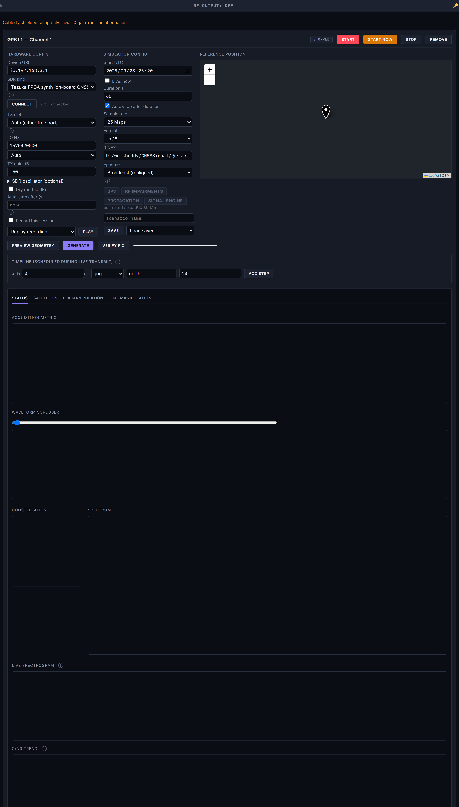

图中正是本场景：Start UTC 2023/09/28 23:20、时长 60 秒、25 Msps、int16，RINEX 指向当日广播星历，地图上的红色 marker 落在坦佩雷。

### 第二步：先看天上看得到几颗星

点 **Preview geometry**，后端立刻用广播星历推算出该时刻该位置的可见卫星：

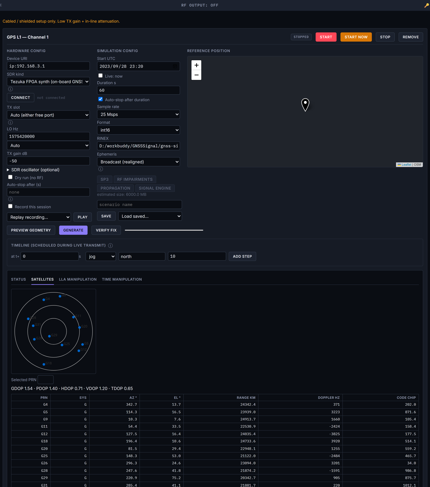

12 颗 GPS 卫星入网：星空图上高矮错落地分布，表格给出每颗星的方位/仰角/伪距/多普勒——伪距 22000~25000 km、多普勒 ±4 kHz 以内，与真实物理量级完全一致。GDOP 1.54、PDOP 1.40，几何构型相当好。

### 第三步：一键生成中频信号

点 **Generate**，进度条开始走。C++ 引擎逐块合成 12 颗星的下扩信号（导航电文扩频、载波调制、多普勒/码率随几何变化、叠加高斯白噪声），60 秒场景共 15 亿复采样点、约 6 GB：

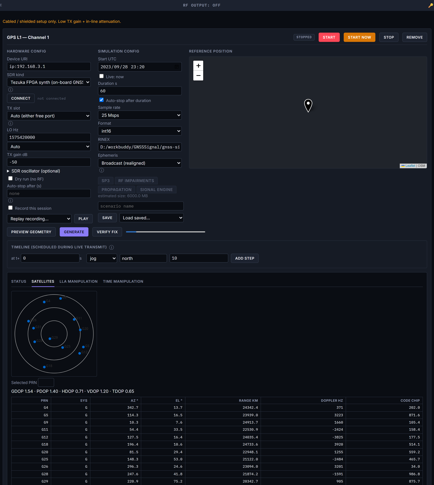

生成约 18 秒完成后，Status 页会自动亮出验证视图（见下一步）。

### 第四步：仿真器的自我证明 —— Verify Fix

点 **Verify Fix**，内置软件接收机对刚生成的 gpssim.bin 做一轮完整的捕获 → 伪距提取 → 最小二乘定位，并与地图 marker 真值比对：

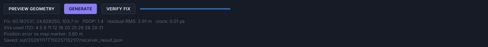

实测结果：**Fix 60.182531°N, 24.828250°E，PDOP 1.4，伪距残差 RMS 2.91 m，12 颗星全部入解，位置误差 3.80 m**。界面里还有一张仿真器独有的"自我证明书"——每颗星的理论码相位/多普勒与实测值并排：

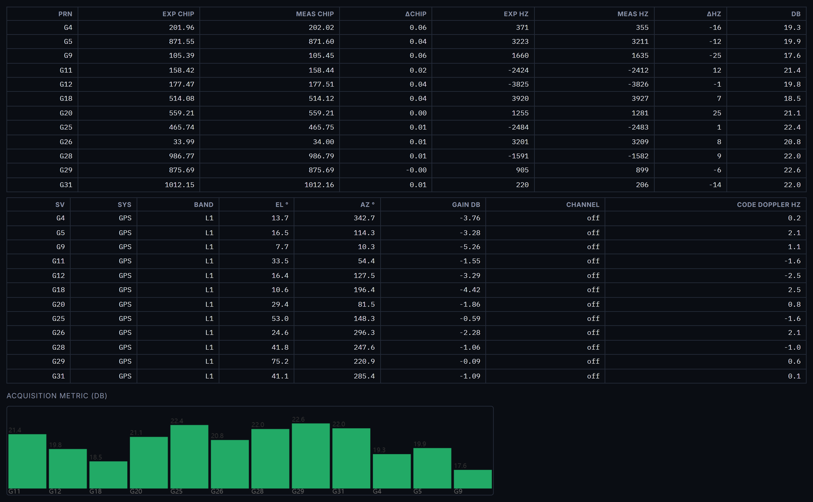

EXP/MEAS 两列（理论/实测）逐星吻合：码相位偏差 ≤0.09 chips，多普勒偏差 ≤25 Hz。由于生成端与接收端是两套独立代码，这一轮等价于端到端回归测试：信号里的伪距、多普勒、导航电文全部自洽。

一个关键细节：内置验证器不写死改正模型，而是读取本次 run 在 `meta.json` 里的注入记录——生成端实际注入了哪些大气/钟差项，它就只改正哪些。本轮界面生成 run 注入了 Klobuchar 电离层与 Saastamoinen 对流层延迟，验证器就同样扣减这两项（3.80 m 中约 0.9 m 在水平、3.7 m 在垂直）。**"只改正被注入的东西"**，是仿真器自我证明的第一原则；稍后第七步会看到，违背这条原则的代价有多大。

后端的处理流水留痕在 Log 页，每一轮验证都记入日志：

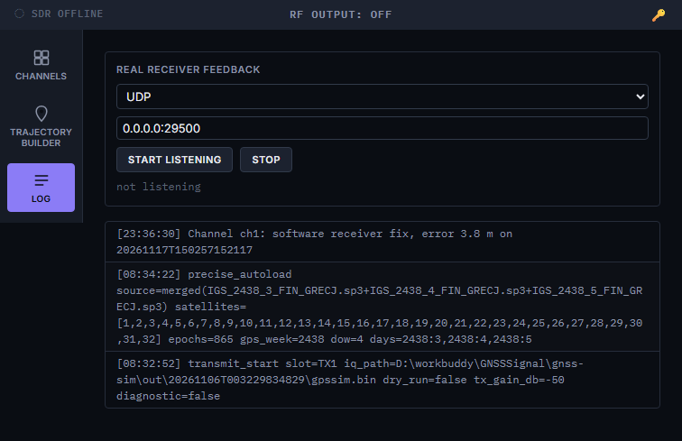

### 第五步：把信号交给 PocketSDR

gnss-sim 管生成，真正的"第三方考官"是 PocketSDR。递给它的，是上面同一参数下关掉大气延迟重新生成的那份 IQ（同样 6 GB，下文简称"回放文件"）。把它交给 PocketSDR 的回放服务器（`pocket_web`），浏览器打开 WebUI，输入端选中文件、格式 CS16（int16）、25 MHz、中心频点 1575.42 MHz。本节所有截图与数字，都出自**未经任何修改的 PocketSDR v0.22 原版构建**：

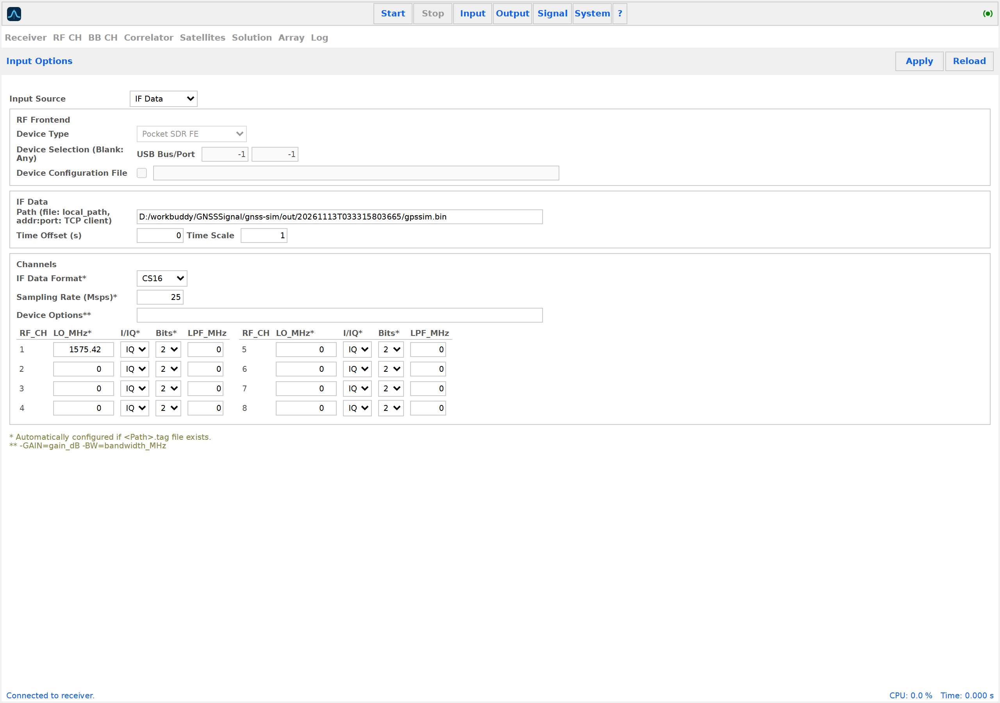

Signal 页里只勾 GPS L1CA，卫星号 4,5,9,11,12,18,20,25,26,28,29,31：

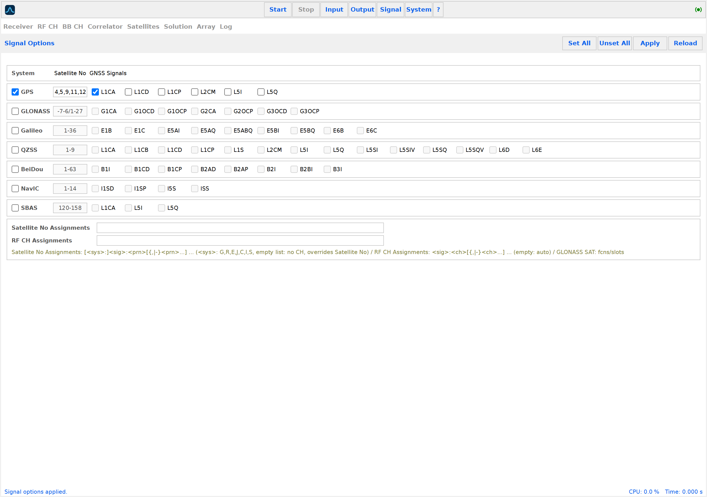

点 **Start**，回放开始。约 10~20 秒内，12 路捕获通道逐路锁定。

### 第六步：看着接收机"活"起来

**Correlator 页**是跟踪环的心电图——每条曲线是一个通道的早期/即时/晚期相关器功率，锁定时 IP 峰高高耸立、EP/LP 对称分布：

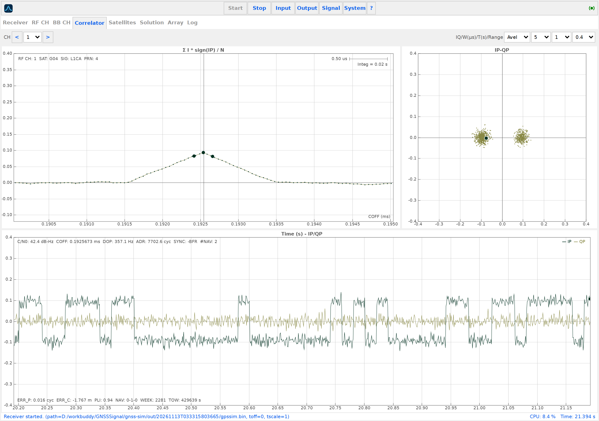

图上是 PRN 4 通道锁定后的样子：相关峰干净地立在 0.1925 ms 码相位处，C/N0 42.4 dB-Hz，右侧 IP-QP 散点聚成紧密的对称双簇——这是 Costas 环 ±180° 相位模糊下、导航电文比特翻转的标准形态；下方时间序列里 IP 的正负交替，正是正在流入的导航电文 0/1。

**Satellites 页**给出每颗星的跟踪状态与 C/N0 载噪比：

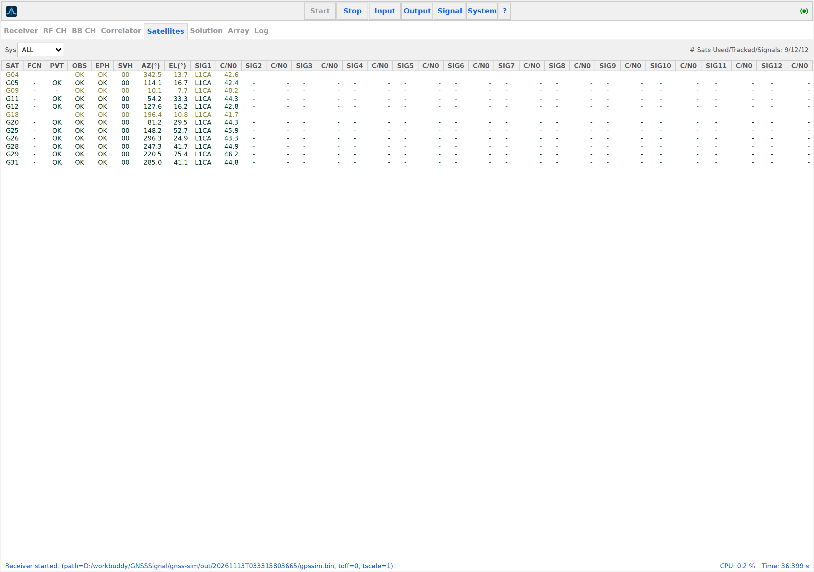

12 颗星的 OBS/EPH/SVH 三关全过，C/N0 在 40.6~46.0 dB-Hz 之间，与场景设定的噪声功率一致；右上角 9/12 FIX——15° 高度角掩码滤掉了三颗低仰角星，9 星参与定位。

**Log 页**能直接看到接收机吐出的 `$CH`（通道状态）、`$OBS`（伪距）、`$SAT`、`$POS`（定位解）实时流：

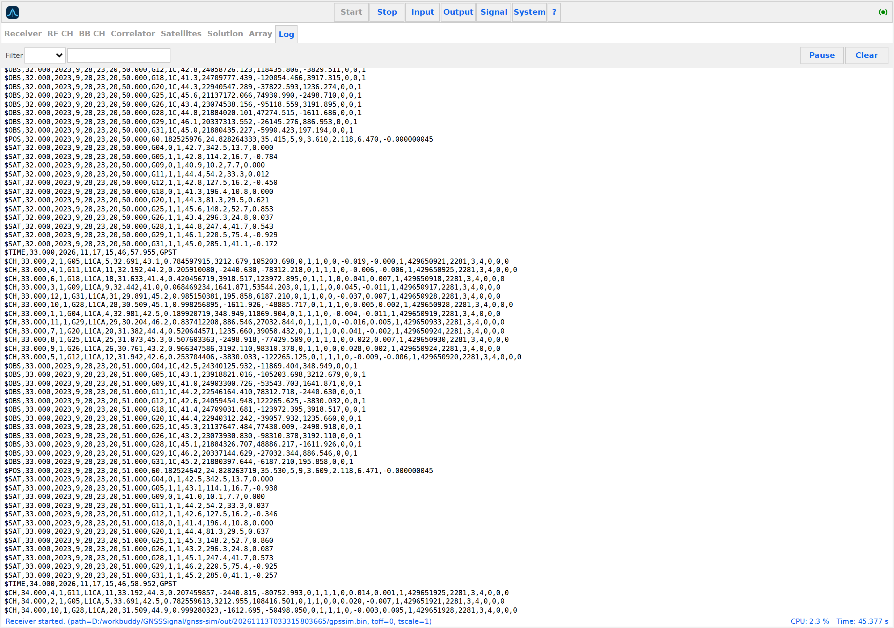

最后切到 **Solution 页**，定位解逐秒刷新：

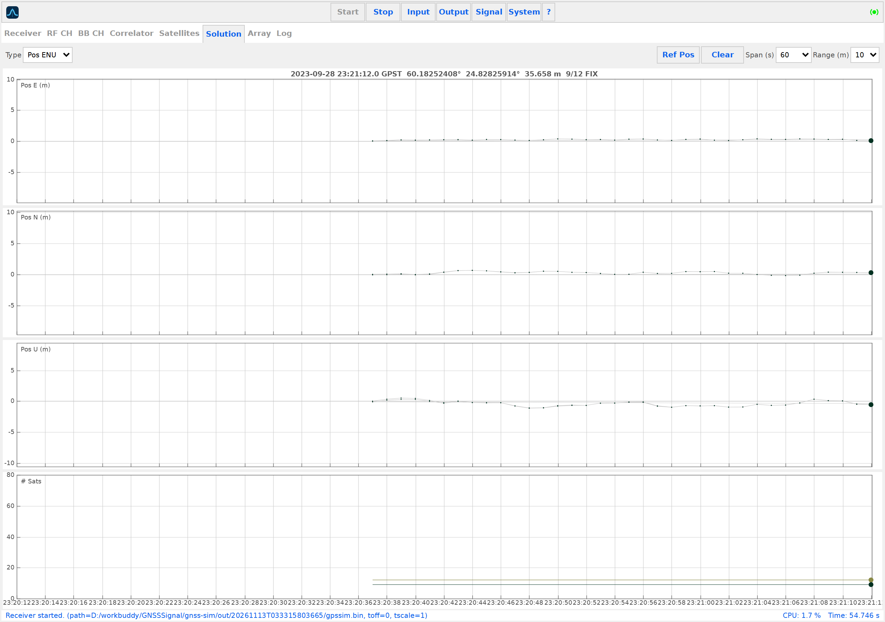

首 FIX 出现在回放第 **19 秒**；60 秒场景共 **41 个定位解**，E/N 曲线全程贴着 ±1 m 抖动。但请留意 Solution 页标题栏的高程读数：**35.7 m**——而场景真值的椭高是 47.2 m。水平漂在米级，垂直却差了十一米多。先按下不表，下一步再来算这笔账。

### 第七步：让改正模型对齐注入模型——垂直误差归零

垂直那十几米从哪来？捕获、跟踪、电文解码都是健康的——41 个解的码相位和比特流干净得很；问题出在最后一站 PVT。PocketSDR 的定位解算基于 RTKLIB，源码 `sdr_pvt.c` 的 `update_sol()` 里**写死**了两个大气改正开关：对流层用 Saastamoinen 经验模型，电离层用 Klobuchar 广播模型。对流层那项只要测站坐标和卫星仰角就能算出非零延迟，必扣无疑；电离层那项依赖的广播参数被生成端无条件写进了导航电文，也在扣。可我们回放的这份场景**大气延迟是关闭的——IQ 里根本不存在大气延迟**。接收机在给每颗星扣一个不存在的、与仰角相关的延迟，这部分错误经最小二乘投影，恰好放大在垂直方向。

用命令行对同一份 IQ 做了组内对照：原版（两个模型都开）垂直平均误差 **−11.45 m**；只关电离层 → −8.79 m；只关对流层 → −2.91 m；**两个都关 → +0.06 m**。归因清楚：对流层假扣贡献约 −8.5 m，电离层假扣约 −2.7 m——与 Saastamoinen 模型在天顶到 15° 仰角斜路径上 2.3~8.7 m 的量级严丝合缝。

于是按照"只扣生成端实际注入的东西"这条铁律，把 `sdr_pvt.c` 那两行改成关闭重编一个双 OFF 构建，回放**同一份 IQ**：

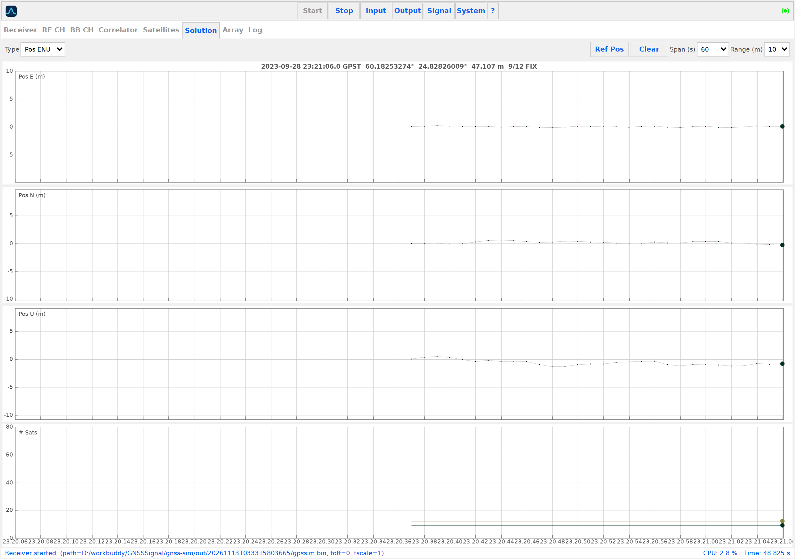

首 FIX 第 **18 秒**，41/41 个解全部有效，**水平 RMS 0.23 m、垂直 RMS 0.45 m**，3D 误差均值 0.20 m（最好历元 0.07 m）；标题栏高程 47.107 m，距真值 47.248 m 只剩 14 厘米。同一份信号、同一套接收机代码，差别只在改正模型与注入模型配没配对，垂直精度提升了 25 倍。

## 结果与分析

两段同参数的 6 GB IQ、两个完全独立的接收机实现（PocketSDR 另附一个模型对齐构建），三份结果：

| 接收机 | 首 FIX | 定位解数 | 水平精度 | 垂直精度 | 备注 |
|---|---|---|---|---|---|
| gnss-sim 内置接收机 | — | 单次最小二乘 | 0.9 m | 3.7 m | 3D 误差 3.80 m，PDOP 1.4，残差 RMS 2.91 m；界面生成轮（大气已注入，按 meta.json 注入记录改正） |
| PocketSDR 原版（WebUI 回放） | 19 s | 41（1 Hz） | RMS 1.46 m | RMS 11.44 m | 9/12 星（15° 高度角掩码）；对未注入的大气做错扣 |
| PocketSDR both-off | 18 s | 41（1 Hz） | **RMS 0.23 m** | **RMS 0.45 m** | 同一份回放文件；大气改正与场景注入对齐 |

几点观察：

- **两条链互相印证。** 生成端与接收端共三套独立代码，各轮的伪距、多普勒与定位结果都同场景真值对得上账，这本身就是对仿真可信度最强的背书；
- **垂直十米级误差不是单频码定位的宿命，而是"改正模型与注入模型错配"的症状**——同一份 IQ、同样是 9 颗星，被迫扣减未注入的大气延迟时垂直 RMS 11.44 m；模型对齐后垂直 RMS 0.45 m，只比水平 0.23 m 大约一倍。垂直劣化于水平的倍数本应由星几何决定（本场景 PDOP 1.4），十米量级全部来自那笔不存在的"大气账"；
- **C/N0 完全可预期。** 场景噪声功率是显式设定，收到的载噪比落在 40~46 dB-Hz 并与仰角分布吻合；
- **物理量级肉眼可查。** 伪距 22000~25000 km、多普勒 ±4 kHz、GDOP 1.54，与真实天空下的量级一致。

## 结语

从一次鼠标点击生成信号，到另一个开源程序解出位置，全链路都在浏览器里完成——这是开源 GNSS 工具链的小确幸。有了这个闭环，你可以：

- 给接收机算法做**回归测试**：同一份 IQ，改一行代码前后各跑一次；
- 做**故障注入**：在 meta.json 的 provenance 里改动卫星钟差参数，看接收机能否察觉；
- 做**教学演示**：相关峰、载噪比、DOP，抽象概念全部变成屏幕上会动的曲线。

下一步剧透：在这个框架里加入 Galileo E1+E5a 双频场景与 IFLC 无电离层组合，验证双频对电离层延迟的消除效果——欢迎持续关注。

---

*工具获取：*
- *gnss-sim：https://github.com/HomeInSnow/gnss-sim*
- *PocketSDR：https://github.com/tomojitakasu/PocketSDR（ver. 0.22）*
