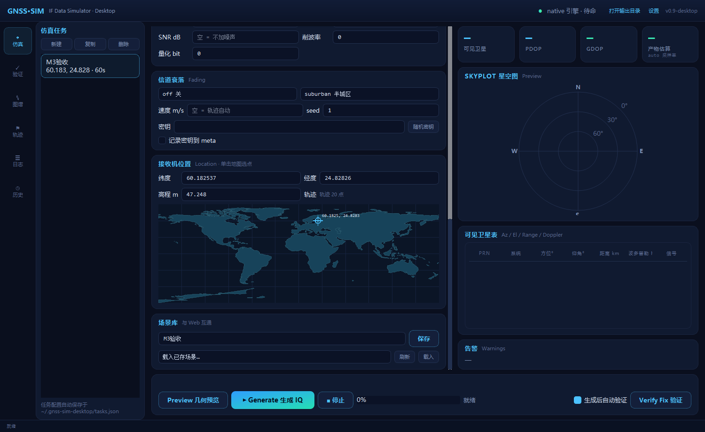
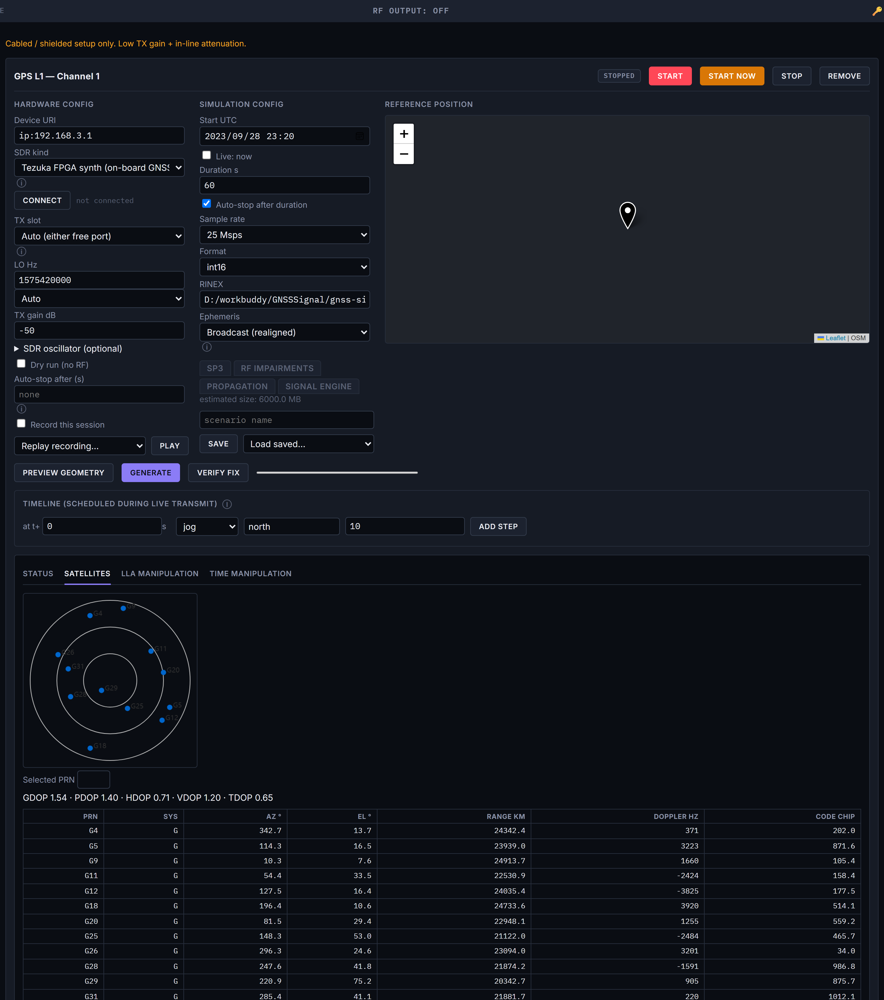

# 从仿真到定位（上）：用 gnss-sim 把坦佩雷的天空"写"出来，仿真器自己当裁判

> 开源工具链 gnss-sim 能把一份场景配置逐比特写成 6 GB 中频 IQ，并用内置软件接收机对生成结果完成自检，全程不需要天线与射频硬件。本文为上篇，讲生成端；信号交给第三方接收机的表现，见下篇《从仿真到定位（下）：PocketSDR 重解那份 6 GB 信号》。Web 版与 Windows 桌面版均可完成全文流程。

## 引言：为什么需要"仿真—接收"闭环

真实卫星信号的获得完全不受控：无法指定某颗卫星在给定时刻出现在给定仰角，无法让电离层"不捣乱"，也无法把同一段信号重放用于回归测试。软件仿真是解决之道：生成端把星座轨道、导航电文、传播时延与噪声信道逐比特写成中频 IQ 采样；接收端将其视为天线收到的真实信号，照常捕获、跟踪、解码、定位。两端相互独立，以通用 IQ 文件格式为界，构成可复现、可注入、可度量的闭环。

本系列分两篇：

- **本篇（上篇）**讲生成端：用场景化仿真器 **gnss-sim**（https://github.com/HomeInSnow/gnss-sim）搭建场景、生成 GPS L1 C/A 中频 IQ，并由内置软件接收机验证生成结果；
- **下篇**讲接收端：把 IQ 交给筑波大学教授、RTKLIB 作者高須知治（Tomoji Takasu）的开源软件接收机 **PocketSDR**（https://github.com/tomojitakasu/PocketSDR）回放，验证"改正模型须与注入模型对齐"这一核心原则。

## 主角：gnss-sim——场景化信号仿真生成器

gnss-sim 的输入是一份场景：接收机位置、仿真时段、星座与频段、采样率与量化位深，以及可选的大气延迟、卫星钟差、多径、衰落等传播损伤。输出是与 gps-sdr-sim 生态兼容的 **int8/int16 交织 IQ 二进制文件（gpssim.bin）**，外加记录全部输入与来源的 `meta.json`：逐星轨道参数、导航电文版本、引擎版本均写入 provenance，实验可溯源、可复现。

架构分三层，界面有两种形态：

| 层 | 实现 | 职责 |
|---|---|---|
| 界面 | Web 单页应用；**Windows 桌面版**（PySide6 原生窗口，打包 exe 双击即用） | 场景配置、几何预览、生成进度、验证展示 |
| 后端 | Python（Web 走 FastAPI，桌面版走进程内 Service 层） | 场景调度、RINEX 星历解析、接收机自检 |
| 引擎 | 原生 C++20（ctypes 加载） | 逐卫星信号合成：码/载波调制、导航电文、多频段 |

桌面版与 Web 版复用同一生成与验证内核，验收时同一场景经两条链路生成的 gpssim.bin 逐字节一致（sha256 比对）；桌面版无需浏览器、无需起服务。

该工具的特点是"仿真—验证一体"：生成 IQ 后可立即由内置软件接收机做捕获、伪距提取与最小二乘定位，与场景真值比对，误差直接显示——仿真器自己当自己的裁判。

## 实战：GPS L1 C/A，坦佩雷 60 秒

场景：芬兰坦佩雷（60.1825°N, 24.8283°E）固定接收机，2023-09-28 23:20:00 UTC 起 60 秒，GPS L1 C/A 单频，采样率 25 Msps、int16 量化，卫星钟差开启，大气延迟按界面默认注入 Klobuchar+Saastamoinen。同一参数下另行生成一份**关闭大气延迟**的干净 IQ，用于下篇的第三方回放——原因见文末。

### 第一步：搭建场景

一个通道卡片就是一张"场景工单"：左侧填硬件与仿真参数，中间选星座，右侧地图上点选接收机位置。桌面版仿真页同构（三栏：配置卡片 / 星空图与可见星表 / 底部动作条），另提供场景库与 Web 互操作。

图中即本场景：Start UTC 2023-09-28 23:20、时长 60 秒、25 Msps、int16，RINEX 指向当日广播星历，marker 落在坦佩雷。

### 第二步：几何预览

点 **Preview geometry**，后端用广播星历推算该时刻该位置的可见卫星：

12 颗 GPS 卫星入网，表格给出逐星方位/仰角/伪距/多普勒：伪距 22000~25000 km、多普勒 ±4 kHz 以内，GDOP 1.54、PDOP 1.40，量级与真实天空一致。

### 第三步：生成中频信号

点 **Generate**，C++ 引擎逐块合成 12 颗星的下扩信号（导航电文扩频、载波调制、多普勒与码率随几何变化、叠加高斯白噪声）。60 秒场景共 15 亿复采样点、约 6 GB，生成耗时约 18 秒：

### 第四步：内置接收机验证（Verify Fix）

点 **Verify Fix**，内置软件接收机对刚生成的 gpssim.bin 做完整的捕获 → 伪距提取 → 最小二乘定位，并与真值比对：

结果：**Fix 60.182531°N, 24.828250°E，PDOP 1.4，伪距残差 RMS 2.91 m，12 颗星全部入解，位置误差 3.80 m**。逐星理论/实测对照表：

EXP/MEAS 两列逐星吻合：码相位偏差 ≤0.09 chips，多普勒偏差 ≤25 Hz。生成端与验证端是两套独立代码，本轮等价于一次端到端回归测试。

关键机制：内置验证器不写死改正模型，而是读取本次 run 在 `meta.json` 中的注入记录——生成端实际注入了哪些大气/钟差项，就只改正哪些。本轮注入了 Klobuchar 电离层与 Saastamoinen 对流层延迟，验证器同样扣减这两项（3.80 m 中约 0.9 m 水平、3.7 m 垂直）。**"只改正被注入的东西"**是仿真器自我证明的第一原则；其价值与代价在下篇完整呈现。

后端处理流水在 Log 页逐轮留痕：

## 本篇结果

- 一份 6 GB 的 gpssim.bin：12 颗星、60 秒、完整导航电文，外加记录一切输入与来源的 `meta.json`；
- 一份内置接收机签发的"自检报告"：伪距、多普勒、定位三关全过，3.80 m 对得上场景真值；
- 伪距 22000~25000 km、多普勒 ±4 kHz、GDOP 1.54，物理量级逐项可查。

## "自我证明"不等于"第三方认可"

内置验证器与生成端虽是独立代码，其改正策略却跟随本次 run 的注入记录——这保证了自洽，也留下一个盲区：**若生成端存在系统性错误，验证器可能与之"错错相消"**。真正的外部检验需要一个改正模型不受仿真器控制的第三方：PocketSDR 的 RTKLIB 定位内核中，大气如何改正、采用什么模型，都写死在源码里。

留给下篇的两个问题：

1. 交给第三方回放的是另外生成的"大气关闭"干净版，而不是本节这份注入了大气的 IQ，为什么；
2. 对一份不存在大气延迟的信号，第三方接收机起初高程解漂移约**十一米**——水平仍是米级，垂直却比内置验证器的 3.7 m 差近三倍——这十一米从何而来、如何归零。

## 结语（上篇）

从一次点击到 6 GB 中频信号落盘并通过自检，生成端闭环合拢。这份可溯源的 IQ 可用于：接收机算法**回归测试**（同一份 IQ，改代码前后各跑一次）；**故障注入**（改动 provenance 中的钟差等参数，观察接收机反应）；**教学演示**（星空图、伪距、DOP 全部可视化）。以上流程在 Web 版与桌面版中都可完成。

下篇是"接收"的重头戏：同一份信号、另一个开源世界的接收机，以及那笔十一米的"大气账"。

---

*工具获取：*
- *gnss-sim：https://github.com/HomeInSnow/gnss-sim（Web 版与 Windows 桌面版）*
- *PocketSDR：https://github.com/tomojitakasu/PocketSDR（ver. 0.22，另附桌面版 PocketSDR Desktop）*
