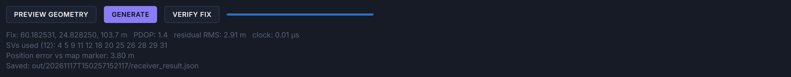
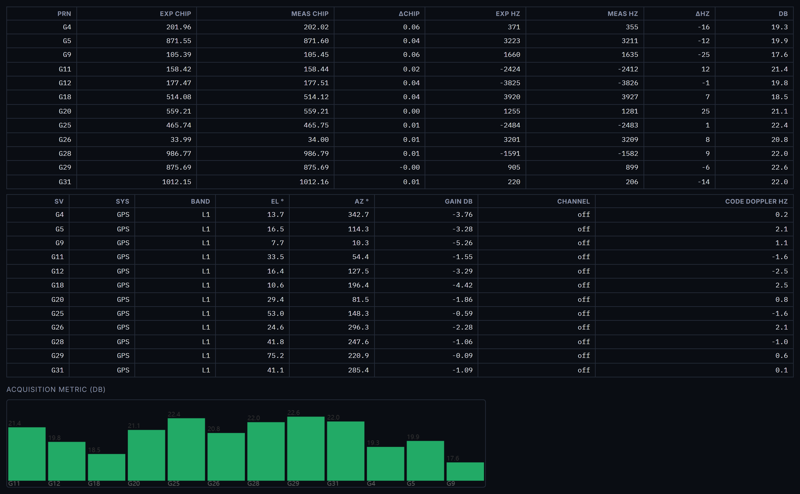
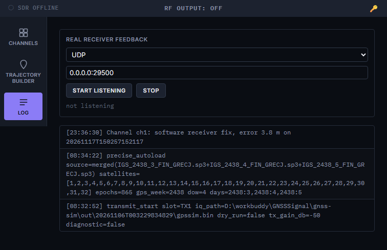

# 从仿真到定位（上）：用 gnss-sim 把坦佩雷的天空"写"出来，仿真器自己当裁判

> 一套开源工具链，让你在办公室里没有天线、没有射频，也能从一张"场景工单"开始，把卫星信号逐比特写成 6 GB 中频 IQ——然后让仿真器自己当自己的裁判。本文为上篇；信号交给第三方考官的表现，请看下篇《从仿真到定位（下）：PocketSDR 重解那份 6 GB 信号》。

## 引言：为什么需要"仿真—接收"闭环

做 GNSS 算法的人都有体会：真实卫星信号是"可遇不可求"的试验品。你无法命令天上的 GPS PRN 11 在 23:20 出现在坦佩雷上空仰角 7.6° 的位置；无法让电离层"今天先别捣乱"；更无法让同一段信号原封不动地重放一百次用于回归测试。

软件仿真是破局的关键：**生成端**把星座轨道、导航电文、传播时延、噪声信道逐比特"写"成一串中频 IQ 采样；**接收端**则把这串数据当作天线收来的真实信号，照常捕获、跟踪、解码、定位。两端各自独立，中间以业界通用的 IQ 文件格式为界，正好构成一个可复现、可注入、可度量的闭环。

这个闭环，本系列拆成两篇各讲一半：

- **本篇（上篇）**讲生成端：用场景化仿真器 **gnss-sim**（本项目自研，托管于 https://github.com/HomeInSnow/gnss-sim）搭建场景、一键生成 GPS L1 C/A 中频 IQ，再让仿真器内置的软件接收机给自己打分；
- **下篇《从仿真到定位（下）：PocketSDR 重解那份 6 GB 信号》**讲接收端：把上篇写出的 IQ 交给筑波大学教授、RTKLIB 作者高須知治（Tomoji Takasu）的开源 GNSS 软件接收机 **PocketSDR**（https://github.com/tomojitakasu/PocketSDR），在浏览器 WebUI 里回放到底，并揭开"接收机改正模型 vs 注入模型"错配的秘密。

全程只需一个浏览器。

## 主角：gnss-sim —— 场景化信号仿真生成器

gnss-sim 的输入是一个"场景"：接收机位置、仿真时段、星座与频段、采样率与量化位深，以及可选的大气延迟、卫星钟差、多径、衰落等传播损伤。输出是一个与 gps-sdr-sim 生态兼容的 **int8/int16 交织 IQ 二进制文件（gpssim.bin）**，外加一份记录全部输入参数与来源的 `meta.json`——每一颗星的轨道参数、导航电文版本、引擎版本都写进 provenance，实验可溯源、可复现。

它的架构分三层：

| 层 | 实现 | 职责 |
|---|---|---|
| 前端 | 原生 JS 单页应用 | 场景配置、几何预览、生成进度、验证结果可视化 |
| 后端 | Python（FastAPI） | 场景调度、RINEX 星历解析、接收机自检 |
| 引擎 | 原生 C++20（ctypes 加载） | 逐卫星信号合成：码/载波调制、导航电文、多频段 |

值得强调的是"仿真—验证一体"：gnss-sim 内置了一个软件接收机，生成完 IQ 后可以立即对自己的产物做捕获、伪距提取和最小二乘定位，把定位结果与场景真值比对，误差直接显示在界面上。仿真器自己当自己的裁判。

## 实战：GPS L1 C/A，坦佩雷 60 秒

下面走一遍生成端的完整流程。场景设定：芬兰坦佩雷（60.1825°N, 24.8283°E）固定接收机，2023-09-28 23:20:00 UTC 起 60 秒，GPS L1 C/A 单频，采样率 25 Msps、int16 量化，卫星钟差开启；大气延迟按界面默认注入 Klobuchar+Saastamoinen——这是交给内置接收机做"自我证明"的那一轮。同一参数下我们还生成了第二份**关闭大气延迟**的干净 IQ，它是下篇主角，为什么非要另一份、且为什么偏偏关大气，文末揭晓。

### 第一步：在 Web 界面上搭场景

打开 gnss-sim 的界面，一个通道卡片就是一张"场景工单"：左边填硬件与仿真参数，中间选星座，右边地图上点一下就是接收机位置。

图中正是本场景：Start UTC 2023/09/28 23:20、时长 60 秒、25 Msps、int16，RINEX 指向当日广播星历，地图上的红色 marker 落在坦佩雷。

### 第二步：先看天上看得到几颗星

点 **Preview geometry**，后端立刻用广播星历推算出该时刻该位置的可见卫星：

12 颗 GPS 卫星入网：星空图上高矮错落地分布，表格给出每颗星的方位/仰角/伪距/多普勒——伪距 22000~25000 km、多普勒 ±4 kHz 以内，与真实物理量级完全一致。GDOP 1.54、PDOP 1.40，几何构型相当好。

### 第三步：一键生成中频信号

点 **Generate**，进度条开始走。C++ 引擎逐块合成 12 颗星的下扩信号（导航电文扩频、载波调制、多普勒/码率随几何变化、叠加高斯白噪声），60 秒场景共 15 亿复采样点、约 6 GB：

生成约 18 秒完成后，Status 页会自动亮出验证视图（见下一步）。

### 第四步：仿真器的自我证明 —— Verify Fix

点 **Verify Fix**，内置软件接收机对刚生成的 gpssim.bin 做一轮完整的捕获 → 伪距提取 → 最小二乘定位，并与地图 marker 真值比对：

实测结果：**Fix 60.182531°N, 24.828250°E，PDOP 1.4，伪距残差 RMS 2.91 m，12 颗星全部入解，位置误差 3.80 m**。界面里还有一张仿真器独有的"自我证明书"——每颗星的理论码相位/多普勒与实测值并排：

EXP/MEAS 两列（理论/实测）逐星吻合：码相位偏差 ≤0.09 chips，多普勒偏差 ≤25 Hz。由于生成端与接收端是两套独立代码，这一轮等价于端到端回归测试：信号里的伪距、多普勒、导航电文全部自洽。

一个关键细节：内置验证器不写死改正模型，而是读取本次 run 在 `meta.json` 里的注入记录——生成端实际注入了哪些大气/钟差项，它就只改正哪些。本轮界面生成 run 注入了 Klobuchar 电离层与 Saastamoinen 对流层延迟，验证器就同样扣减这两项（3.80 m 中约 0.9 m 在水平、3.7 m 在垂直）。**"只改正被注入的东西"**，是仿真器自我证明的第一原则；这条原则的价值与代价，下篇会让你看到完整的一面。

后端的处理流水留痕在 Log 页，每一轮验证都记入日志：

## 到此为止，你已经拥有

- 一份 6 GB 的 gpssim.bin：12 颗星、60 秒、带完整导航电文的中频信号，外加记录一切输入与来源的 `meta.json`；
- 一份仿真器签发的"自我证明书"：伪距、多普勒、定位三关全过，3.80 m 对得上场景真值；
- 伪距 22000~25000 km、多普勒 ±4 kHz、GDOP 1.54——所有物理量级肉眼可查，与真实天空一致。

## 但"自我证明"不等于"第三方认可"

内置验证器与生成端虽是两套完全独立的代码，它的改正策略却跟着本次 run 的注入记录走——这是自我证明的美德（永远自洽），却也意味着一个盲区：**如果生成端犯系统性错误，内置验证器会跟着"错错相消"**。要真正把信号当外人检验，需要一个改正模型不受我们控制的第三方考官：PocketSDR 的 RTKLIB 定位内核里，大气怎么改、用什么模型，都是写死在源码里的。

所以下篇会有两个答案：

1. 交给第三方回放的，为什么是我们另外生成的"大气关闭"干净版，而不是本节这份注入了大气的 IQ；
2. 一个反直觉的现象：对一份"干净到不存在大气延迟"的信号，第三方接收机起初反而把高程解漂了**十一米**——水平依然是米级，垂直却比上篇内置验证器的 3.7 m 还差了近三倍。这十一米从哪来、又怎么归零，全部在下篇。

## 结语（上篇）

从一次鼠标点击，到 6 GB 中频信号落盘并通过自我检验——生成端这一半的闭环已经合拢。有了这份可溯源的 IQ，你可以：

- 给接收机算法做**回归测试**：同一份 IQ，改一行代码前后各跑一次；
- 做**故障注入**：在 meta.json 的 provenance 里改动卫星钟差参数，看接收机能否察觉；
- 做**教学演示**：星空图、伪距、DOP，抽象概念全部变成屏幕上会动的图表。

而下篇才是"接收"的重头戏：同一份信号、另一个开源世界的接收机，以及那笔十一米的"大气账"。欢迎关注下一篇《从仿真到定位（下）：PocketSDR 重解那份 6 GB 信号》。

---

*工具获取：*
- *gnss-sim：https://github.com/HomeInSnow/gnss-sim*
- *PocketSDR：https://github.com/tomojitakasu/PocketSDR（ver. 0.22）*
