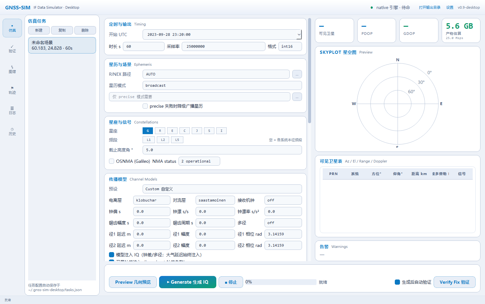
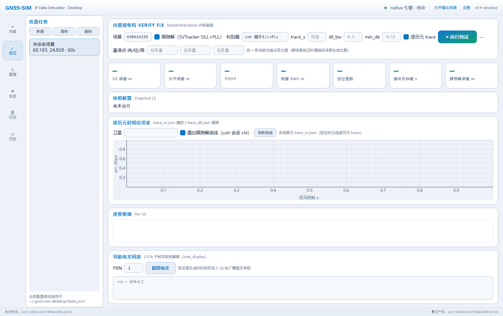
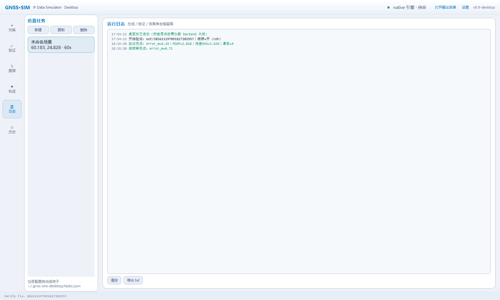

# 从仿真到定位（上）｜零硬件、双击即用：一台把「生成—验证」闭环做进桌面的 GNSS 信号仿真器

> 本文介绍开源项目 **gnss-sim-desktop**：它把 GNSS 信号仿真做成"场景配置 → 生成中频 IQ → 内置接收机跟踪解自检"的单机闭环，不需要天线和射频硬件，也不需要浏览器与本地服务。全文以 GPS L1 C/A 信号为例，说明这个工具做什么、性能如何、内部怎样工作，以及它对科研和学习的实际支持作用。下篇介绍接收端 PocketSDR Desktop。

## 一、这个工具是什么

gnss-sim-desktop 接收一份场景描述：接收机位置、仿真时段、星座与频段、采样率与量化位深，加上可选的大气延迟、卫星钟差、高斯噪声、多径、衰落等注入项。输出两样东西：

- **gpssim.bin**：交织 IQ 二进制中频信号，与 gps-sdr-sim 生态（PocketSDR、RTKLIB 等）直接兼容；
- **meta.json**：本次生成的全部输入、星历来源、注入参数与随机种子，逐一落档。

生成之后，同窗口内置的软件接收机对 gpssim.bin 做捕获、逐星载波/码环跟踪与最小二乘定位，与场景真值比对，直接给出跟踪解位置误差、PDOP、残差 RMS、逐星码相位偏差等指标——**内置自检走的是完整的跟踪解路径，而不是快照式定位**：只有环路真正闭合之后的码相位与载波相位观测，才配得上"这份信号是可以被真实接收机解出来的"这句话。程序为 PySide6 原生窗口，Release 页下载解压后双击 exe 即用；随包内置多系统广播星历缓存，**完全离线也能跑多星座场景**。界面共六页：**仿真、验证、图谱、轨迹、日志、历史**。

## 二、与上游项目的继承关系和改进

gnss-sim-desktop 的上游是开源信号仿真器 **gps-sdr-sim** 谱系：项目保留了直接调用 gps-sdr-sim 可执行文件的传统生成路径（`backend/generator.py`），沿用其命令行场景模型与 IQ 落盘格式，输出文件因此能被整个 gps-sdr-sim 生态无改动回放；桌面形态则从开源项目 gnss-sim 的谱系独立维护而来（2026 年 9 月起 300+ 次提交的持续演进）。在此基础上的主要改动：

| 方面 | gps-sdr-sim（上游） | gnss-sim-desktop（本项目） |
|---|---|---|
| 使用形态 | 命令行程序，参数手敲 | 桌面 exe 六页界面；场景库保存/复制/删除 |
| 生成引擎 | C 源码单二进制 | 自研原生 C++20 引擎（ctypes 进程内调用），保留传统路径可选 |
| 星座频段 | GPS L1 C/A 为主 | GPS/GLONASS/Galileo/BeiDou/QZSS/SBAS 多系统多频段 |
| 导航电文 | GPS LNAV | 完整 25 页 LNAV（UTC 块、天文历等），并有 BeiDou D1、Galileo I/NAV 等逐系统编解码器 |
| 结果验证 | 无，需外接接收机判断 | 内置接收机以**跟踪解**自检：捕获 → 相干 E/L + Costas PLL 逐星闭合 → 锚定伪距 → 最小二乘，误差预算与导航电文回放在同一页面 |
| 可溯源性 | 无 | meta.json 全量 provenance；固定种子使同一场景逐字节可复现 |
| 信道损伤 | 基本 | 高斯噪声（目标 SNR + 种子）、多径、衰落可在界面注入 |
| 星历 | 广播星历 | 广播星历 + precise SP3 模式 |

改进的取舍原则是一贯的：**格式向生态兼容，能力向科研需求扩展，交互向单机可用收敛**。

## 三、L1 C/A 信号与生成原理

先看被仿真的对象。GPS L1 C/A 的三个基本参数：

| 项目 | 值 |
|---|---|
| 载波频率 | 1575.42 MHz |
| C/A 码速率 | 1.023 Mcps（1023 码片，周期 1 ms） |
| 导航电文 | LNAV，50 bps；1 比特 = 20 个码周期（20 ms），一帧 30 s |

生成端的工作，本质上是对每颗卫星、每个采样点回答三个问题：信号此刻的**码相位**是多少、**载波相位**是多少、**幅度**该多大。流水如下：

1. **星历与卫星状态**：按仿真日期自动匹配当日广播星历（RINEX 文件填 `AUTO` 即可），逐星做开普勒传播得到位置、速度与钟差改正（含 Sagnac 项）；
2. **几何与伪距**：伪距 = 卫星到接收机的几何距离 + 钟差项 + 注入的大气项（若勾选）。本项目的一个明确策略是**大气/钟差"只注入被勾选的、验证时只改正被注入的"**——注入清单原样写进 meta.json，验证器据此逐项扣减，杜绝自洽盲区；
3. **信号合成**：native 引擎按块累加各卫星贡献——码发生器按码相位取 PRN 芯片、乘以扩频符号，载波按多普勒频移产生复指数，导航电文按当前发射时刻 TOW 取字；所有卫星叠加后按 int8/int16 量化成交织 IQ 落盘；
4. **损伤注入**：按目标 SNR 计算噪声功率、用固定种子叠加高斯白噪声，可选多径与衰落。

验证端与生成端是完全独立的两套代码，全程以**跟踪解**完成。以 L1 C/A 为例：

1. **捕获**：FFT 并行多普勒搜索（±6 kHz、250 Hz 间隔，1 ms 相干累加 ×10 次非相干），以捕获度量（dB）过门限者入解；
2. **跟踪**：每颗星一个独立的 SVTracker 会话，相干 Early/Late 码环 + Costas 载波锁相环（默认模式，另有非相干 E/L、峰追踪两种可切换），逐码周期输出码相位偏差 chi 与连续累积的载波相位；比特翻转沿窗口由 Costas 符号判决处理，跨窗相位不断链；
3. **伪距构造（锚定法）**：不依赖解调 TOW——用广播星历把伪距预测到位，环路收敛后的实测码相位偏差换算成米修正预测值，再按 meta.json 注入清单逐项扣减卫星钟差与大气延迟（没注入的不扣，防止"改正出不存在的误差"）；
4. **定位**：含公共钟差的最小二乘，逐历元与场景真值比对，输出跟踪解位置误差、PDOP、伪距残差 RMS 与逐星 err_chips / 相位抖动。

## 四、桌面版功能走查（实测场景）

场景取一个**北纬 60° 的高纬度城市环境**（坐标见截图参数区，高程约 47 m）——高纬天空几何恶劣、对流层路径延迟偏大，是对接收链更有压力的考题。仿真自 2023-09-28 23:20:00 UTC 起 60 秒，GPS L1 C/A 共 12 颗可见星，25 Msps、int16；注入 Klobuchar 电离层 + Saastamoinen 对流层 + 卫星钟差，高斯白噪声目标 SNR −18.33 dB（固定种子 2281271）。**注意这份信号是"大气、钟差全开"的全要素版**——下篇 PocketSDR 标准接收机验证的正是同一份数据。

仿真页三栏：左侧参数卡片，右上星空图，右下可见星表；底部 Preview 与 Generate。

Preview 用广播星历推算可见卫星，12 颗星全部入网，星表给出逐星方位、仰角、伪距、多普勒，KPI 条显示 PDOP 1.40、GDOP 1.54；伪距 2.0~2.5 万 km、多普勒 ±4 kHz 以内，与真实天空量级一致。

Generate 之后，15 亿复采样点、6,000,000,000 字节的 gpssim.bin 落盘（约 5.6 GB），耗时不到一分钟，页面提示输出目录。

验证页填入目录、勾选"跟踪解（SVTracker DLL+PLL）"即得完整自检报告：KPI 卡片以**跟踪解 3D 误差**为主指标，配 PDOP、残差 RMS、入解星数；下方逐历元曲线默认叠加跟踪会话的码相位偏差（coh chi），逐星明细给出每颗星的 err_chips、相位抖动、多普勒与仰角，另有 L1C/A 子帧级导航电文回放区。

每一步的参数、耗时与结果都在日志页留痕，可导出：

## 五、性能数据（均为本机实测）

以下数字来自上述场景及同参数短场景的直接运行结果：

- **生成吞吐**：25 Msps × 60 s × int16（6 GB）单机一分钟内完成；
- **跟踪解精度**：主场景（全要素注入 + 噪声，捕获质量门限 12 dB）跟踪解 3D 误差 **0.72 m**，PDOP 1.49，11 星入解，伪距残差 RMS 0.29 m；逐星码相位偏差（环路原始残差）RMS 0.0059 码片，最小二乘测量均值后降到 0.0012 码片（≈0.36 m）；锁定点上残余相位抖动（线性去趋势后）0.017 周，折 L1 载波约 3 mm；Costas 跨比特判决全程零掉锁。同场景在无噪声短场景上，跟踪解 3D 误差可进一步收敛到 0.12~0.17 m、逐星码相位偏差中位数 0.0012 码片；
- **捕获稳健性**：捕获扫描覆盖广播星历全部 PRN（1..33）。实测度量分布：带噪声场景真星 10~16 dB、噪声假峰 4~6 dB，捕获门限按工况定标（本场景取 12 dB）而不是写成常数；验证页 `min_db` 字段可现场上调下调；
- **环路品质**：相干模式（E/L 相干判别 + Costas PLL）相对非相干 E/L 与峰追踪，同场景定位误差低一个量级，是桌面版默认模式。

## 六、对科研与学习的实际支持

**可复现的基准数据**。固定随机种子后，同一场景生成的 IQ 逐字节一致。算法改一行代码，拿同一份文件重跑即得回归结论；这正是仿真相对真实天空的核心优势——一切可控、一切可重放。

**单变量的受控实验**。注入清单由勾选决定，可做教科书中"单因素实验"：只开电离层，观察定位漂移方向与量级；关掉对流层，比较垂直分量变化。这类实验在真实环境里无法安排，在这里是一次点击。

**接收机算法研究的试验台**。内置接收机与生成端代码相互独立，跟踪环三种判别器模式、捕获门限、累加长度、环路带宽、跟踪时长都暴露为界面参数，适合做环路带宽、相干/非相干累加一类对比研究；导航电文编解码器逐系统齐备，可研究电文级问题。

**零硬件的教学闭环**。信号结构（1 ms 码周期、20 ms 比特、30 s 帧）、伪距量级、DOP 概念、环路收敛过程，在星空图、星表、逐历元跟踪曲线上全部可见；学生不需要购置任何射频前端，就能走完"生成信号 → 捕获 → 跟踪 → 定位"的完整链路，且生成的文件与 PocketSDR、RTKLIB 生态兼容，随时可以换第三方接收机对答案。

## 七、当前版本的边界

如实说明：桌面版聚焦仿真与自检，SDR 实时回放发射不在桌面形态内（Web 版有该能力且默认关闭）；内置跟踪解目前覆盖 GPS L1 C/A 与 Galileo E1 路径，其余系统的内置自检能力按版本渐进；大气注入目前覆盖 Klobuchar/Saastamoinen 为主的配置，Galileo 双频 IFLC 属实验特性。

## 结语（上篇）

从一次点击到 6 GB 中频信号落盘并通过跟踪解自检，生成端闭环合拢；这份带 provenance 的 IQ 同时是给第三方接收机的考卷。下篇把**同一份大气、钟差全注入的信号**交给 RTKLIB 作者高須知治的开源软件接收机 PocketSDR **标准版**（其桌面版 PocketSDR Desktop 承担全部操作），讨论接收端的功能、性能、原理——仿真器自己说解得出来不算数，标准接收机把大气按标准做法扣干净、复现亚米级定位，才算闭环。

---

*工具获取：*
- *gnss-sim-desktop（本项目，桌面版 exe）：https://github.com/HomeInSnow/gnss-sim-desktop —— Release v2026.11.19b 下载 Windows x64 zip，解压双击 `gnss-sim-desktop.exe`；随包含覆盖 GPS/GLONASS/Galileo/BeiDou/QZSS/SBAS/NavIC 的三份广播星历缓存，离线可用*
- *上游 gnss-sim 谱系与 gps-sdr-sim：https://github.com/oscar607/gps-sdr-sim*
- *下篇的接收机同样出自筑波大学高須知治教授，即 PocketSDR（ver. 0.22），项目地址 https://github.com/tomojitakasu/PocketSDR*
