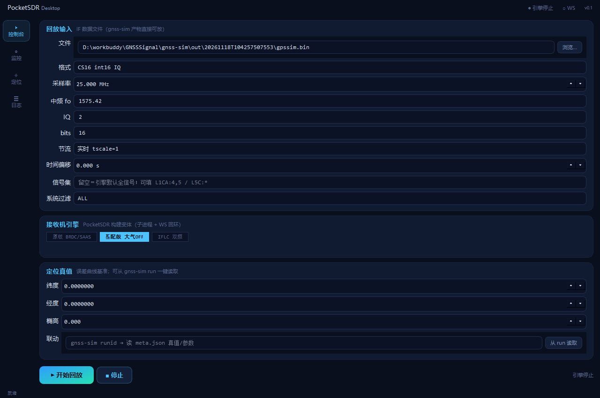
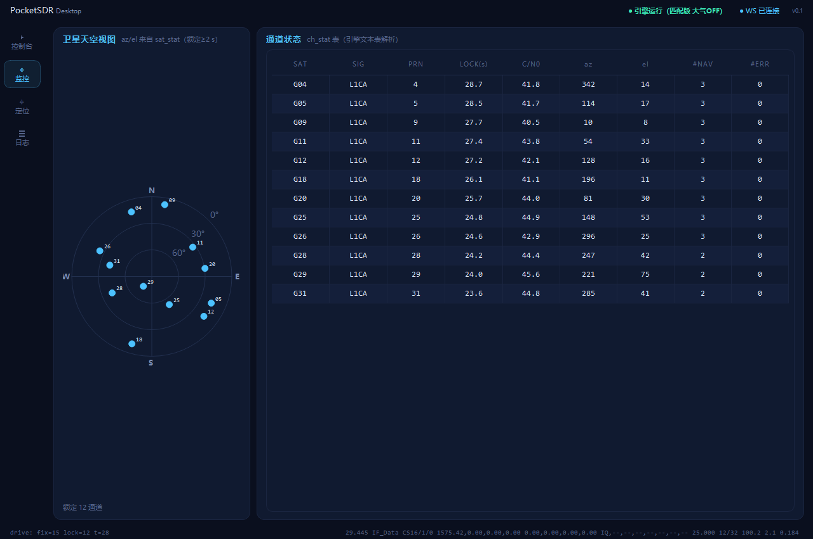

# 从仿真到定位（下）：PocketSDR 重解那份 6 GB 信号，垂直误差从十一米归零

> 上篇中，gnss-sim 桌面版把坦佩雷的天空"写"成 6 GB 中频 IQ，内置接收机以米级误差自洽过审。本篇由第三方考官——RTKLIB 作者高須知治教授的开源软件接收机 PocketSDR 回放同一份信号：水平依旧米级，垂直却先漂了十一米；将改正模型与注入模型对齐后归零。全程在桌面程序中完成。

## 上篇回顾

上篇完成生成端闭环：芬兰坦佩雷（60.1825°N, 24.8282°E）固定接收机，2023-09-28 23:20:00 UTC 起 60 秒，GPS L1 C/A 单频 12 颗星（PRN 4,5,9,11,12,18,20,25,26,28,29,31），25 Msps、int16，卫星钟差开启，Klobuchar+Saastamoinen 大气注入，高斯白噪声按目标 SNR 设定（固定随机种子）；生成约半分钟产出 6 GB gpssim.bin，内置 Verify Fix 与场景真值一致。验证器按 `meta.json` 注入记录"只改正被注入的东西"。

遗留两个问题，本篇按序回答：其一，交给第三方回放的是同一参数下**另外生成的"大气延迟关闭"干净版**；其二，这份不含大气延迟的信号，第三方高程解为何先漂**十一米**、最终归零。

## 主角：PocketSDR——开源 GNSS 软件接收机

PocketSDR 是一套完整的开源 GNSS SDR 接收方案（当前版本 0.22），配套 2/4/8 通道射频前端，也支持 USRP、PlutoSDR、RTL-SDR 等第三方硬件；最轻的用法是不碰硬件、直接回放 IQ 文件。处理流水线为：

1. **PSD 频谱分析**——在宽带 IQ 中定位 GNSS 信号能量；
2. **捕获**——逐星码相位 × 多普勒二维搜索；
3. **跟踪**——载波环（PLL/FLL）+ 码环（DLL）逐毫秒锁相；
4. **导航电文解码**——恢复广播星历；
5. **PVT 解算**——基于 RTKLIB 的单点定位。

本次实战使用其桌面版 **PocketSDR Desktop**（本次配套开发）：PySide6 外壳以子进程拉起官方引擎，打包 exe 双击即用。控制台页集中全部回放参数与引擎变体选择；监测、高级、定位、数据、日志五页覆盖分析全程。

## 实战：回放上篇的信号

### 第五步：把信号交给 PocketSDR Desktop

递给第三方考官的，是同一参数下关闭大气延迟重新生成的那份 IQ（同样 6 GB，下文简称"回放文件"）。控制台页填入：文件（回放文件绝对路径）、格式 CS16（int16）、采样率 25 MHz、中频 1575.42 MHz；信号集留空即引擎默认，配合系统过滤锁定 GPS L1 C/A 的 12 颗卫星（4,5,9,11,12,18,20,25,26,28,29,31）。

引擎卡片提供三个构建变体：**原版**（RTKLIB 默认写死 Klobuchar+Saastamoinen 改正）、**适配版·大气 OFF**（与无大气场景的注入模型对齐）、**IFLC 双频**。定位真值栏可从 gnss-sim run 的 `meta.json` 一键读取，供定位页误差曲线使用。点"开始回放"，约 10~20 秒内 12 路通道逐路锁定。

### 第六步：接收过程观测

**监测页**左侧星空图与右侧通道状态表实时联动：12 颗星 OBS/EPH/SVH 三关全过，锁定秒数逐星累积，C/N0 落在 40.5~45.6 dB-Hz、与仰角分布吻合——场景噪声功率是显式设定，载噪比完全可预期。

**高级页**四联图给出跟踪环的"体检报告"：频谱 PSD 中信号淹没于噪声底；相关峰图上主相关器（E/P/L/P2 分色大点）稳稳立于 0.190 ms 码相位处，C/N0 42.1 dB-Hz；IP-QP 星座聚为对称双簇——Costas 环 ±180° 相位模糊下导航电文比特翻转的标准形态；IP 历史时间序列的正负交替即流入的导航电文比特。PSD 顶部按系统色标注信号频段（GPS L1CA @1575.42 MHz）。

**数据页**逐通道列出 26 列观测全量（锁定、C/N0、码相位 COFF、多普勒、载波相位、伪距/载波残差、导航电文状态、周号/TOW），右表逐星健康与导航标志（定位解/观测/电文/健康标志、方位、仰角）：

**捕获、跟踪、电文解码均健康**——问题出在最后一站 PVT。

### 第七步：改正模型对齐注入模型，垂直误差归零

PocketSDR 的定位解算基于 RTKLIB，源码 `sdr_pvt.c` 的 `update_sol()` 中**写死**两个大气改正开关：对流层用 Saastamoinen 经验模型，电离层用 Klobuchar 广播模型。对流层项凭测站坐标与卫星仰角即可算出非零延迟，必扣；电离层项依赖的广播参数被生成端无条件写入导航电文，也在扣。而这份回放场景**大气延迟是关闭的——IQ 中不存在大气延迟**。接收机为每颗星扣减一个不存在的、与仰角相关的延迟，该误差经最小二乘投影，恰好在垂直方向放大。

这也回答了上篇伏笔：正因 PocketSDR 的改正模型写死在源码、不受仿真器控制，才为其另行准备这份"大气关闭"的干净 IQ——场景越干净，越能将"链路是否通畅"与"接收机改正模型是否配对"两件事分离验证。

用命令行对同一份 IQ 做组内对照（引擎源码级切换两个开关，四组构建各回放一遍）：原版（两模型全开）垂直平均误差 **−11.45 m**；仅关电离层 → **−8.79 m**；仅关对流层 → **−2.91 m**；**两模型全关 → +0.06 m**。归因明确：对流层假扣贡献约 −8.5 m，电离层假扣约 −2.7 m，与 Saastamoinen 模型在天顶至 15° 仰角斜路径上 2.3~8.7 m 的量级吻合。

据此按上篇原则——**"只扣生成端实际注入的东西"**——在控制台页切换到"适配版·大气 OFF"引擎变体，回放**同一份 IQ**：

定位页顶部 KPI：解算数、用星、水平/垂直 RMS 实时刷新；平面轨迹图以 ENU 米显示定位点围绕真值（橙色）的收敛过程；误差曲线逐历元给出水平（青）/垂直（绿）相对真值偏差。本次回放 **30 个历元、10 星锁定、7 星入解，水平 RMS 0.22 m、垂直 RMS 0.26 m**，实时解算行高程 47.091 m，距真值 47.248 m 约 16 厘米——与整场景命令行复测的水平 RMS 0.23 m / 垂直 RMS 0.45 m（41/41 解全有效）一致。同一份信号、同一套接收机代码，差别仅在改正模型与注入模型是否配对，垂直精度提升 25 倍。

## 结果与分析

同参数的两份 6 GB IQ（大气注入版与大气关闭版）、三个独立接收机实现，三份结果：

| 接收机 | 定位解 | 水平精度 | 垂直精度 | 备注 |
|---|---|---|---|---|
| gnss-sim 内置接收机（上篇） | 单次最小二乘 | 米级 | 米级 | 大气已注入，按 meta.json 注入记录改正 |
| PocketSDR 原版（CLI 回放） | 41（1 Hz） | RMS 1.46 m | RMS 11.44 m | 9/12 星（15° 高度角掩码）；对未注入的大气错误扣减 |
| PocketSDR 适配版·大气 OFF | 41/41 有效 | **RMS 0.23 m** | **RMS 0.45 m** | 同一份回放文件；大气改正与场景注入对齐 |

要点：

- **三条链互相印证。** 仿真器、内置接收机、PocketSDR 是三套独立代码，各轮伪距、多普勒与定位结果均与场景真值对账一致，构成对仿真可信度的最强背书；
- **垂直十米级误差不是单频码定位的宿命，而是"改正模型与注入模型错配"的症状。** 同一份 IQ、同样 9 颗星，被迫扣减未注入的大气延迟时垂直 RMS 11.44 m；模型对齐后垂直 RMS 0.45 m，约为水平 0.23 m 的一倍——垂直对水平的劣化倍数本应由几何决定（本场景 PDOP 1.4），十米量级全部来自那笔不存在的大气账；
- **C/N0 完全可预期。** 场景噪声功率显式设定，实测载噪比 40~46 dB-Hz 并与仰角分布吻合；
- **物理量级逐项可查。** 伪距 22000~25000 km、多普勒 ±4 kHz、GDOP 1.54（上篇星空图），与真实天空一致。

## 结语：闭环合拢

从一次点击生成信号（上篇），到另一个开源程序解出位置（本篇），全链路在两个桌面程序中完成。两篇共同的核心结论仍是那条原则：**"只改正被注入的东西"**——生成端注入什么、验证端就改什么；多改一分（错扣不存在的大气）垂直漂十一米，少改一分（漏扣真实注入的延迟）同样露馅。

该框架现已扩展 Galileo E1+E5a 双频场景与 IFLC 无电离层组合。初步对照显示：在无电离层注入的场景中双频组合并不占优——IFLC 的收益恰在于消除电离层，注入侧不提供电离层延迟时，剩余的是 E5a 噪声放大与配对缩水的成本。这也是"只改正被注入的东西"在双频维度的又一次应验，详细数据另文给出。

往期链接：上篇《从仿真到定位（上）：用 gnss-sim 把坦佩雷的天空"写"出来，仿真器自己当裁判》。

---

*工具获取：*
- *gnss-sim：https://github.com/HomeInSnow/gnss-sim（Windows 桌面版）*
- *PocketSDR：https://github.com/tomojitakasu/PocketSDR（ver. 0.22，配套桌面版 PocketSDR Desktop）*
