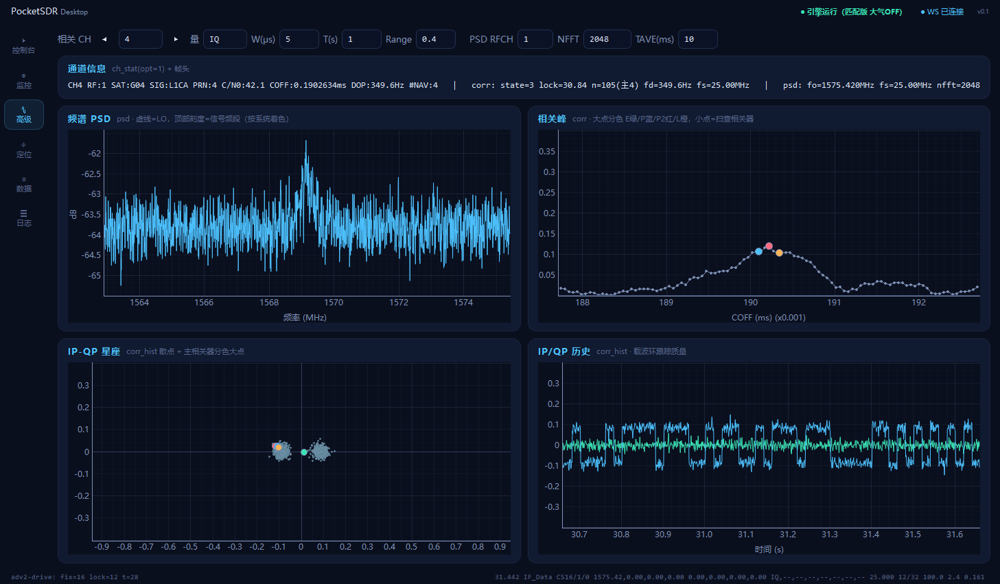
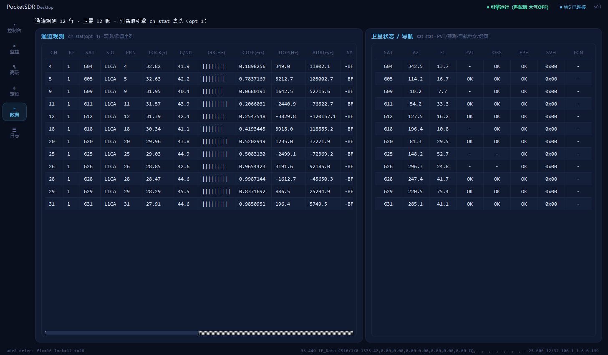
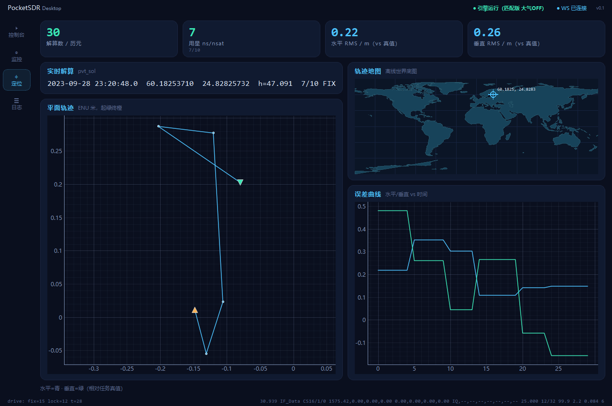

# 从仿真到定位（下）：PocketSDR Desktop 的功能、性能与实现原理（以 L1 C/A 信号回放为例）

> 上篇里，gnss-sim Desktop 把坦佩雷场景生成 6 GB 中频 IQ 并由内置接收机自检通过。本篇讲接收端：用 RTKLIB 作者高須知治的开源软件接收机 PocketSDR 的桌面版 PocketSDR Desktop，回放上篇同参数生成的另一份"大气关闭"信号，检验两个完全独立的开源代码库互相印证的效果。全文同样以 GPS L1 C/A 为例，按功能、性能、原理展开，并说明与上游项目的继承关系。

## 一、这个工具是什么

PocketSDR 是筑波大学教授高須知治维护的开源 GNSS 软件接收机（当前版本 0.22）：捕获、跟踪、导航电文解码、定位解算全部在 CPU 上以软件完成，支持回放 IQ 文件，也支持 USRP、PlutoSDR、RTL-SDR 等前端实时采集。

PocketSDR Desktop 是本项目为它开发的桌面壳：控制台、监控、高级、定位、数据、日志六页的单窗口程序，把原来"命令行 + 浏览器"的操作方式收进一个桌面程序，并增加了几项针对"仿真—接收联合使用"的功能（下节列表）。它不改动接收算法本身——算法引擎仍是 PocketSDR 原版源码编译产物。

## 二、与 PocketSDR 原版的继承关系和改进

继承的部分是核心：捕获/跟踪/电文解码引擎（sdr_func.c、sdr_rcv.c）与基于 RTKLIB 的定位内核（sdr_pvt.c）全部使用上游源码；IQ 回放文件格式（`.bin` + `.tag` 参数文件）、命令行参数、观测与 NMEA 输出也与原版一致——桌面版只是驱动它们。

在此之上的改进：

| 方面 | PocketSDR（上游原版） | PocketSDR Desktop（本项目） |
|---|---|---|
| 使用形态 | 控制台程序 + 自带浏览器界面 | PySide6 单窗口六页，exe 双击即用 |
| 改正配置 | 编译期定死（原版 PVT 固定 BRDC 电离层 + SAAS 对流层） | 三种引擎变体一键切换：**原版 BRDC/SAAS**、**匹配版 大气OFF**、**IFLC 双频** |
| 真值关联 | 手工输入参考坐标 | "从 run 读取"：直接读 gnss-sim 场景 meta.json 的接收机真值，KPI 即对真值的误差 |
| 信号观察 | 浏览器图表（频谱/星座图） | 桌面重实现并扩展：C/N0 与锁定时间列表、IQ/相关峰/星座图（按 E/P/P2/L 角色分色）、PSD 频段刻度 |
| 数据出口 | 日志文件为主 | 观测表（每通道 26 列实时数据）与卫星状态表同屏 |
| 回归测试 | 无 | `--selftest` 自检：驱动完整回放并核对定位输出次数（当前实测 fixes=3 通过） |
| 构建 | MSVC 工程 | 源码级 g++ 独立构建配方；为双频链路加了少量补丁（放开 $EPH 日志掩码、Galileo 轨道源改取 I/NAV、少星段关闭 RAIM-FDE） |

## 三、接收链原理（以 L1 C/A 为例）

回放的输入正是上篇生态的产物：`out/.../gpssim.bin`，CS16（int16 交织 I/Q）、25 Msps、中心频率 1575.42 MHz、60 秒。接收链五级，每级都有对应的界面出口：

1. **下变频与重采样**：文件以零中频读入，按通道数与采样率参数（`.tag` 文件描述）重整；
2. **相关器组**：每通道用前置/立即/滞后（E/P/L）相关器对信号做本地码扩频相关，本地码相位与载波频率由环路闭环调整；细偏置 COFF、相关峰形状在高级页直接可见；
3. **跟踪环**：载波环（锁相/锁频）+ 码环（DLL），锁定质量用 C/N0 与锁定时间衡量，监控页逐星显示；
4. **电文解码**：L1 C/A 的 50 bps LNAV——20 ms 比特同步、奇偶校验、子帧 1-3 取广播星历，从 HOW 字拿到 TOW 完成时间对齐；解码进度以 #NAV 页数显示；
5. **定位解算**：RTKLIB 最小二乘，逐历元输出位置与卫星使用数；定位页对末段历元统计水平/垂直 RMS（相对真值）。

## 四、功能走查（实测截图）

控制台页：回放文件、格式参数、引擎变体卡片、真值联动都在一处。

监控页：12 颗星全部锁定，C/N0 在 40.5~45.6 dB-Hz 之间，锁定时间 23.6~28.7 s（60 s 场景下即开机即锁并全程保持），#NAV 已收 2~3 页——与 LNAV 子帧结构的预期一致。

高级页：单星 IQ、相关峰与星座图，相关器大点按角色分色（E 绿 / P 蓝 / L 橙 / P2 红），PSD 图带 L1 C/A 频段刻度；本例显示细偏置 COFF 0.190 ms、C/N0 42.1 dB-Hz。

数据页：左表为每通道 26 列实时观测量，右表为卫星状态标志。

定位页：30 个历元，10 星锁定、7 星入解，**水平 RMS 0.22 m、垂直 RMS 0.26 m**，末历元高程 47.091 m（场景真值 47.248 m，相差约 16 cm）。

## 五、性能与"改正模型对齐"实验

回放对象是上篇同参数的干净版场景：大气注入关闭、卫星钟差开启、同一种子的高斯白噪声。这个设置专门用来检验接收端的一个方法论问题：**接收机该不该扣大气改正？** 原版 PVT 固定扣 Klobuchar + SAAS，而这份信号里根本不存在大气延迟——扣了就是引入误差。

命令行下同场景四态对照（垂直偏置）：

| 接收配置 | 垂直偏置 |
|---|---|
| 原版（BRDC + SAAS） | −11.45 m |
| 关电离层改正 | −8.79 m |
| 再关对流层改正 | −2.91 m |
| 全关（匹配版） | **+0.06 m** |

逐级剥离显示：错扣的对流层贡献约 8.5 m、电离层约 2.7 m——十一米的高程漂移不是玄学，是可以逐项记账的模型错配。匹配版引擎在全场景 CLI 复测中 41/41 历元出解，水平 RMS 0.23 m、垂直 0.45 m；桌面定位页的 0.22/0.26 m 与之一致。

双频方面做了同方法的推广实验（Galileo E1+E5a，IFLC 消电离层组合，大气同样未注入的场景）：单频场景匹配 3D 3.60 m，IFLC 组合 6.19 m，原版口径 10.93 m。结论直白：**IFLC 的唯一收益是消电离层，场景里没有电离层时双频只剩成本**（E5a 侧噪声放大、双频配对星数缩水）——"只改正被注入的东西"在双频链路同样成立。

## 六、对科研与学习的实际支持

**独立第三方检验**。生成端（gnss-sim）与接收端（PocketSDR）来自两个互不依赖的代码库，改正策略各自独立：仿真器说 3.41 m 合格不算数，第三方接收机 0.22/0.26 m 的互证才算闭环。这正是仿真工作最可信的评审方式。

**最好的"接收机方法课"教材**。上面的十一米案例把抽象原则变成可复现实验：同一份信号，只改接收配置，误差从 −11.45 m 走到 +0.06 m，每项改正的贡献可量化。学生会记住的不只是数字，而是"配置必须匹配信号内容"的排查思路。

**可观测性研究**。C/N0、锁定时间、少星生存能力（本例 7 星入解）、相关峰形状与多径响应的观察，都能用不同 SNR/多径注入的场景批量制造——上篇的生成端负责出题，这里负责答题，形成廉价、可控、可复现的数据闭环。

**源码级研究的低门槛入口**。C 源码结构清晰（引擎三个文件 + RTKLIB），本项目的构建配方与补丁（放开日志掩码、切换轨道源、关 RAIM-FDE）示范了"如何安全地动一台软件接收机"：先建可回归的基线（--selftest），再做单点修改。命令行参数天然可脚本化，适合批量参数实验。

## 七、当前版本的边界

如实说明：实时采集仍走原版命令行/浏览器路径，桌面版聚焦文件回放；IFLC 双频为实验特性，Galileo E1B 侧尚有一个约 +2.5 m 的共模偏置待查；引擎变体按本项目配方源码编译，随桌面版分发预编译产物。

## 结语

两篇文章合起来是一条完整的闭环：gnss-sim Desktop 生成带 provenance 的 L1 C/A 中频信号并自检（3.41 m），PocketSDR Desktop 以独立代码库回放互证（匹配配置下 0.22/0.26 m），并把"改正模型必须与注入模型对齐"从口号变成逐项记账的实验。两个工具都免费开源、都不需要射频硬件，适合放进导航方向的课程、课题组和毕业设计里。

---

*工具获取：*
- *PocketSDR 上游项目：https://github.com/tomojitakasu/PocketSDR（ver. 0.22）*
- *PocketSDR Desktop 与 gnss-sim Desktop：https://github.com/HomeInSnow/gnss-sim（exe 双击即用）*
