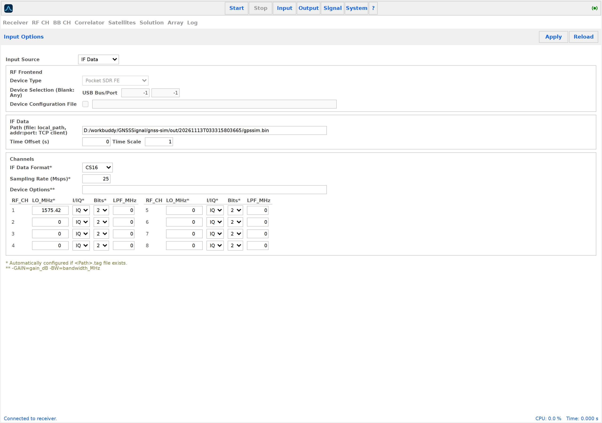
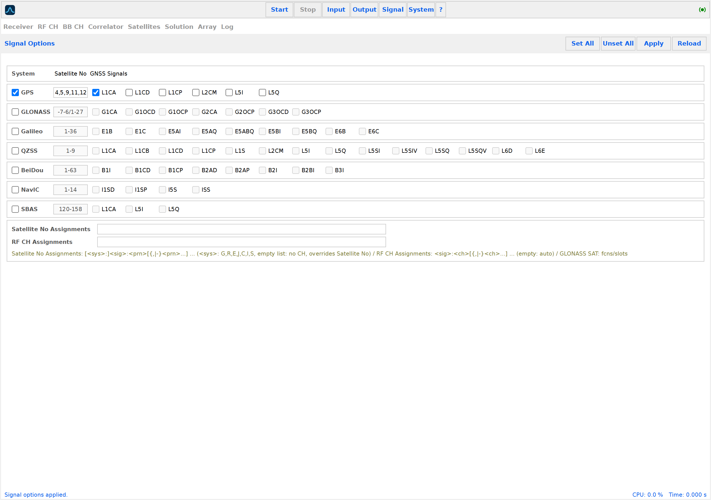
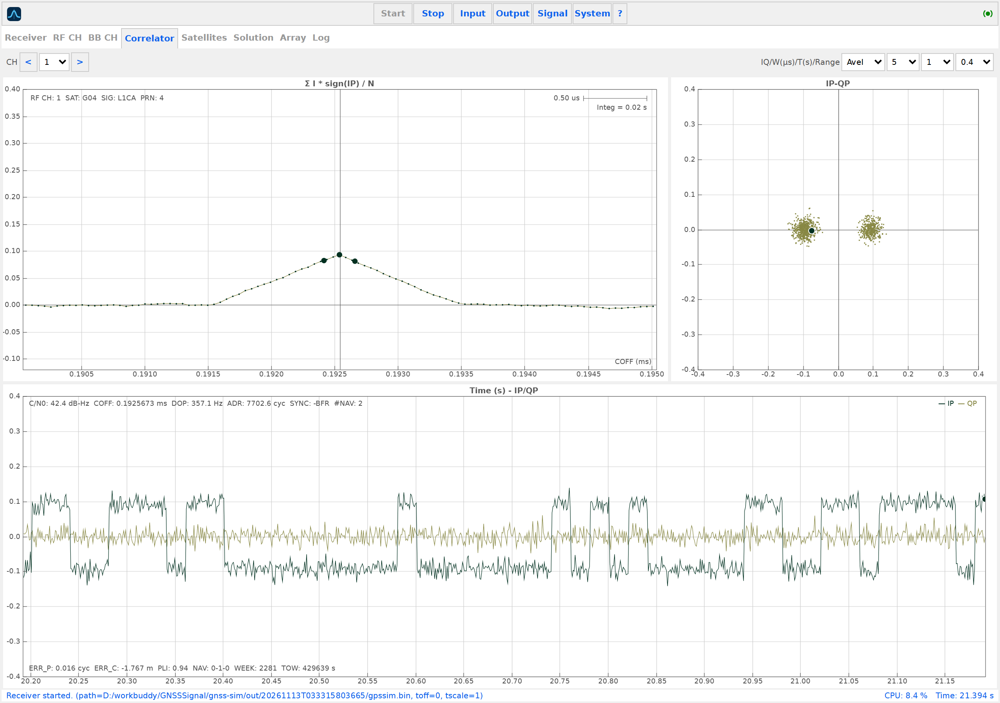
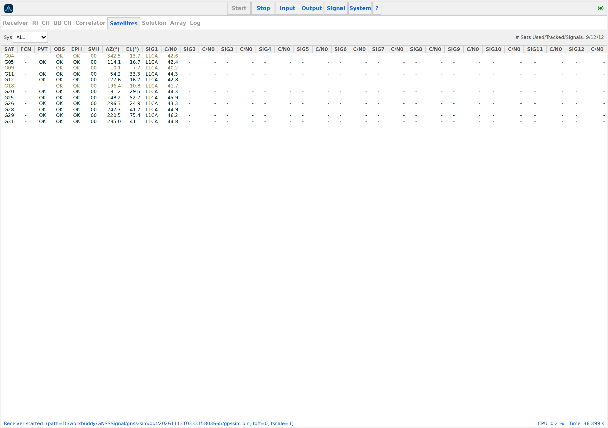
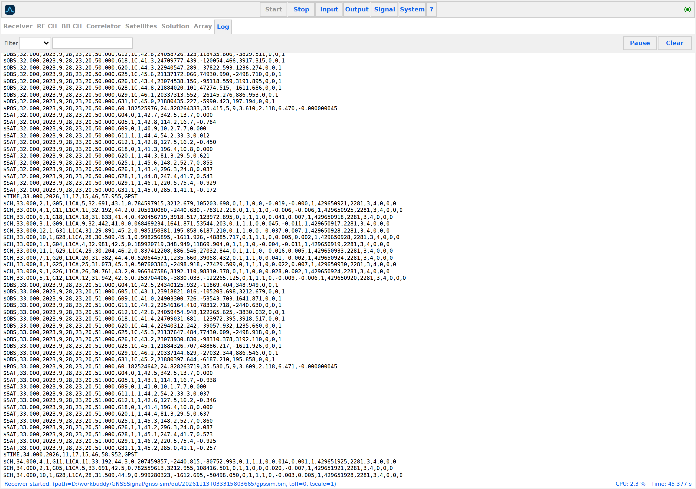
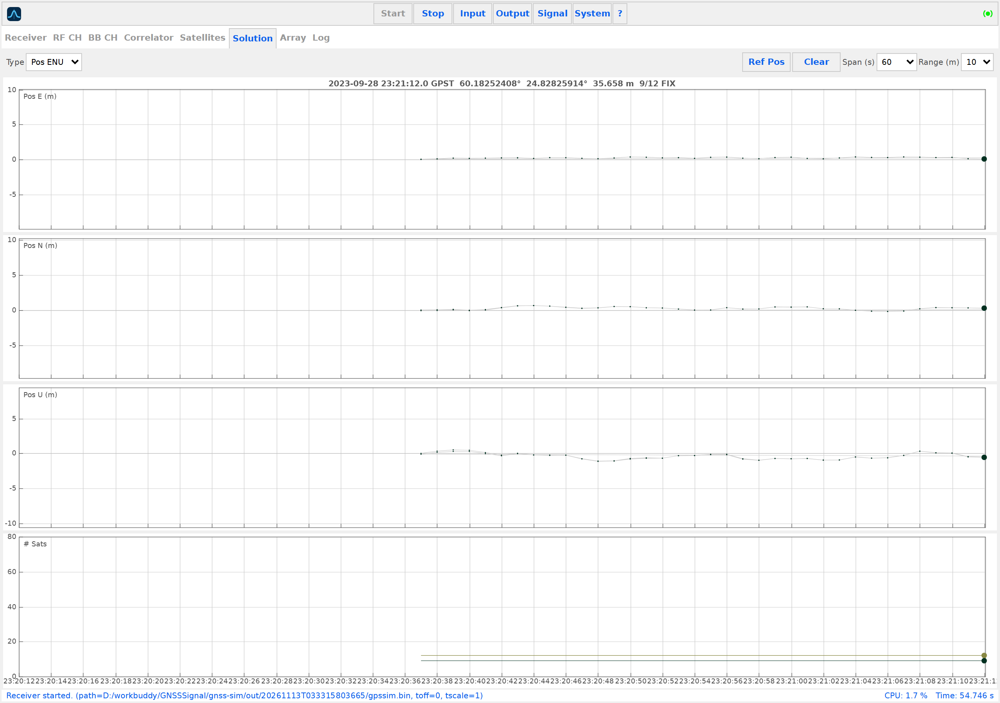
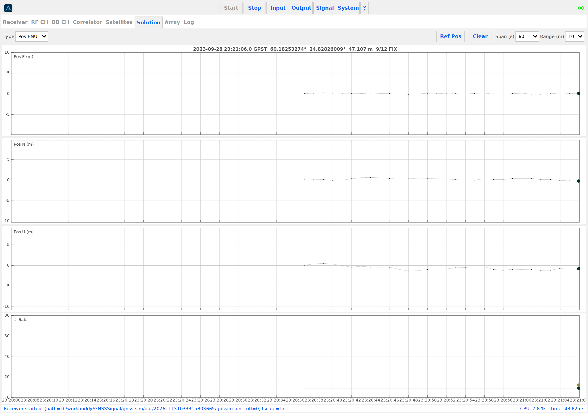

# 从仿真到定位（下）：PocketSDR 重解那份 6 GB 信号，垂直误差从十一米归零

> 上篇里，gnss-sim 把坦佩雷的天空"写"成了 6 GB 中频 IQ，内置接收机 3.80 m 自洽过审。这篇迎来第三方考官——RTKLIB 作者高須知治教授的开源软件接收机 PocketSDR。同一份信号：水平依旧米级，垂直却先漂了十一米，最后归零——全程只需一个浏览器。

## 回顾上篇：留下的两个伏笔

上篇《从仿真到定位（上）：用 gnss-sim 把坦佩雷的天空"写"出来》做完了生成端闭环：芬兰坦佩雷（60.1825°N, 24.8282°E）固定接收机，2023-09-28 23:20:00 UTC 起 60 秒，GPS L1 C/A 单频 12 颗星（PRN 4,5,9,11,12,18,20,25,26,28,29,31），25 Msps、int16，卫星钟差开启；生成约 18 秒产出 6 GB 的 gpssim.bin，内置 Verify Fix 给出 **3.80 m**（PDOP 1.4、伪距残差 RMS 2.91 m、逐星码相位偏差 ≤0.09 chips），内置验证器按 `meta.json` 注入记录"只改正被注入的东西"。

上篇留下两个伏笔：

1. 交给第三方回放的，为什么是同一参数下**另外生成的"大气延迟关闭"干净版**，而不是界面演示那份注入了 Klobuchar+Saastamoinen 的 IQ；
2. 一份"干净到不存在大气延迟"的信号，第三方接收机的高程解为什么会先漂**十一米**、最后又怎么归零。

这一篇按顺序回答。先请出主角。

## 主角：PocketSDR —— 开源 GNSS 软件接收机

PocketSDR 是一套完整的开源 GNSS SDR 接收方案（当前版本 0.22），配套 2/4/8 通道的射频前端，也支持 USRP、PlutoSDR、RTL-SDR 等第三方 SDR 硬件。但它最"轻"的用法是完全不碰硬件：**直接回放 IQ 文件**。

它的处理流水线是教科书式的：

1. **PSD 频谱分析** —— 在宽带 IQ 里找到 GNSS 信号的能量脚印；
2. **捕获（Acquisition）** —— 对每颗卫星做码相位 × 多普勒二维搜索；
3. **跟踪（Tracking）** —— 载波环（PLL/FLL）+ 码环（DLL）逐毫秒锁相；
4. **导航电文解码** —— 恢复广播星历；
5. **PVT 解算** —— 基于 RTKLIB 的单点定位。

从命令行到基于浏览器的实时 WebUI（Signal 勾选、Correlator 相关峰、Satellites 载噪比、Solution 定位结果一应俱全），PocketSDR 把软件接收机的每一层都摊开在用户眼前，是学习和验证接收机算法的绝佳教具。

## 实战：回放上篇的信号

### 第五步：把信号交给 PocketSDR

gnss-sim 管生成，真正的"第三方考官"是 PocketSDR。递给它的，是上篇提到过的、同一参数下关掉大气延迟重新生成的那份 IQ（同样 6 GB，下文简称"回放文件"）。把它交给 PocketSDR 的回放服务器（`pocket_web`），浏览器打开 WebUI，输入端选中文件、格式 CS16（int16）、25 MHz、中心频点 1575.42 MHz。本节所有截图与数字，都出自**未经任何修改的 PocketSDR v0.22 原版构建**：

Signal 页里只勾 GPS L1CA，卫星号 4,5,9,11,12,18,20,25,26,28,29,31：

点 **Start**，回放开始。约 10~20 秒内，12 路捕获通道逐路锁定。

### 第六步：看着接收机"活"起来

**Correlator 页**是跟踪环的心电图——每条曲线是一个通道的早期/即时/晚期相关器功率，锁定时 IP 峰高高耸立、EP/LP 对称分布：

图上是 PRN 4 通道锁定后的样子：相关峰干净地立在 0.1925 ms 码相位处，C/N0 42.4 dB-Hz，右侧 IP-QP 散点聚成紧密的对称双簇——这是 Costas 环 ±180° 相位模糊下、导航电文比特翻转的标准形态；下方时间序列里 IP 的正负交替，正是正在流入的导航电文 0/1。

**Satellites 页**给出每颗星的跟踪状态与 C/N0 载噪比：

12 颗星的 OBS/EPH/SVH 三关全过，C/N0 在 40.6~46.0 dB-Hz 之间，与场景设定的噪声功率一致；右上角 9/12 FIX——15° 高度角掩码滤掉了三颗低仰角星，9 星参与定位。

**Log 页**能直接看到接收机吐出的 `$CH`（通道状态）、`$OBS`（伪距）、`$SAT`、`$POS`（定位解）实时流：

最后切到 **Solution 页**，定位解逐秒刷新：

首 FIX 出现在回放第 **19 秒**；60 秒场景共 **41 个定位解**，E/N 曲线全程贴着 ±1 m 抖动。但请留意 Solution 页标题栏的高程读数：**35.7 m**——而场景真值的椭高是 47.2 m。水平漂在米级，垂直却差了十一米多，比上篇内置验证器的 3.7 m 还差了近三倍。先按下不表，下一步再来算这笔账。

### 第七步：让改正模型对齐注入模型——垂直误差归零

垂直那十几米从哪来？捕获、跟踪、电文解码都是健康的——41 个解的码相位和比特流干净得很；问题出在最后一站 PVT。PocketSDR 的定位解算基于 RTKLIB，源码 `sdr_pvt.c` 的 `update_sol()` 里**写死**了两个大气改正开关：对流层用 Saastamoinen 经验模型，电离层用 Klobuchar 广播模型。对流层那项只要测站坐标和卫星仰角就能算出非零延迟，必扣无疑；电离层那项依赖的广播参数被生成端无条件写进了导航电文，也在扣。可我们回放的这份场景**大气延迟是关闭的——IQ 里根本不存在大气延迟**。接收机在给每颗星扣一个不存在的、与仰角相关的延迟，这部分错误经最小二乘投影，恰好放大在垂直方向。

到这里，上篇的伏笔一并解开：正因为 PocketSDR 的改正模型写死在源码里、不受仿真器控制，我们才特意给第三方考官准备了这份"大气关闭"的干净 IQ——场景越干净，越能把"链路通不通"和"接收机的改正模型与注入模型配没配对"这两件事分开看清。

用命令行对同一份 IQ 做了组内对照：原版（两个模型都开）垂直平均误差 **−11.45 m**；只关电离层 → −8.79 m；只关对流层 → −2.91 m；**两个都关 → +0.06 m**。归因清楚：对流层假扣贡献约 −8.5 m，电离层假扣约 −2.7 m——与 Saastamoinen 模型在天顶到 15° 仰角斜路径上 2.3~8.7 m 的量级严丝合缝。

于是按照上篇立下的那条铁律——**"只扣生成端实际注入的东西"**——把 `sdr_pvt.c` 那两行改成关闭重编一个双 OFF 构建，回放**同一份 IQ**：

首 FIX 第 **18 秒**，41/41 个解全部有效，**水平 RMS 0.23 m、垂直 RMS 0.45 m**，3D 误差均值 0.20 m（最好历元 0.07 m）；标题栏高程 47.107 m，距真值 47.248 m 只剩 14 厘米。同一份信号、同一套接收机代码，差别只在改正模型与注入模型配没配对，垂直精度提升了 25 倍。

## 结果与分析

两段同参数的 6 GB IQ、两个完全独立的接收机实现（PocketSDR 另附一个模型对齐构建），三份结果：

| 接收机 | 首 FIX | 定位解数 | 水平精度 | 垂直精度 | 备注 |
|---|---|---|---|---|---|
| gnss-sim 内置接收机（上篇） | — | 单次最小二乘 | 0.9 m | 3.7 m | 3D 误差 3.80 m，PDOP 1.4，残差 RMS 2.91 m；界面生成轮（大气已注入，按 meta.json 注入记录改正） |
| PocketSDR 原版（WebUI 回放） | 19 s | 41（1 Hz） | RMS 1.46 m | RMS 11.44 m | 9/12 星（15° 高度角掩码）；对未注入的大气做错扣 |
| PocketSDR both-off | 18 s | 41（1 Hz） | **RMS 0.23 m** | **RMS 0.45 m** | 同一份回放文件；大气改正与场景注入对齐 |

几点观察：

- **两条链互相印证。** 生成端与接收端共三套独立代码（上篇的仿真器与内置接收机、下篇的 PocketSDR），各轮的伪距、多普勒与定位结果都同场景真值对得上账，这本身就是对仿真可信度最强的背书；
- **垂直十米级误差不是单频码定位的宿命，而是"改正模型与注入模型错配"的症状**——同一份 IQ、同样是 9 颗星，被迫扣减未注入的大气延迟时垂直 RMS 11.44 m；模型对齐后垂直 RMS 0.45 m，只比水平 0.23 m 大约一倍。垂直劣化于水平的倍数本应由星几何决定（本场景 PDOP 1.4），十米量级全部来自那笔不存在的"大气账"；
- **C/N0 完全可预期。** 场景噪声功率是显式设定，收到的载噪比落在 40~46 dB-Hz 并与仰角分布吻合；
- **物理量级肉眼可查。** 伪距 22000~25000 km、多普勒 ±4 kHz、GDOP 1.54（上篇星空图），与真实天空下的量级一致。

## 结语：闭环合拢

从一次鼠标点击生成信号（上篇），到另一个开源程序解出位置（本篇），全链路都在浏览器里完成——这是开源 GNSS 工具链的小确幸。而两篇连起来看，最有价值的其实是那条反复出现的铁律：**"只改正被注入的东西"**——生成端注入什么、验证端就改什么，多改一分（错扣不存在的大气）垂直漂十一米，少改一分（漏扣真实注入的延迟）同样会露馅。

下一步剧透：在这个框架里加入 Galileo E1+E5a 双频场景与 IFLC 无电离层组合，验证双频对电离层延迟的消除效果——欢迎持续关注。

往期链接：上篇《从仿真到定位（上）：用 gnss-sim 把坦佩雷的天空"写"出来，仿真器自己当裁判》。

---

*工具获取：*
- *gnss-sim：https://github.com/HomeInSnow/gnss-sim*
- *PocketSDR：https://github.com/tomojitakasu/PocketSDR（ver. 0.22）*
