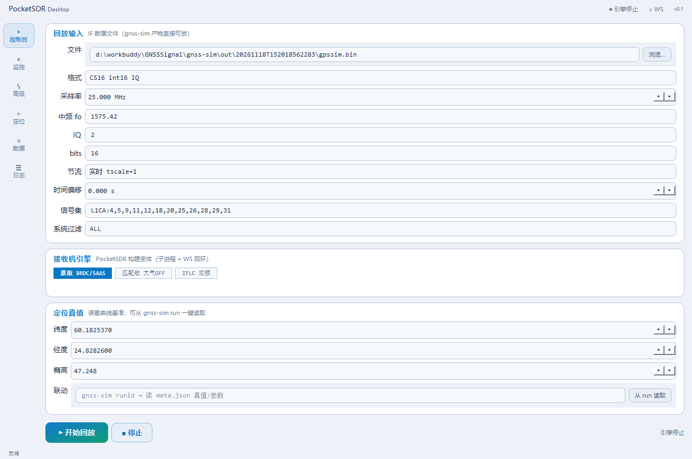
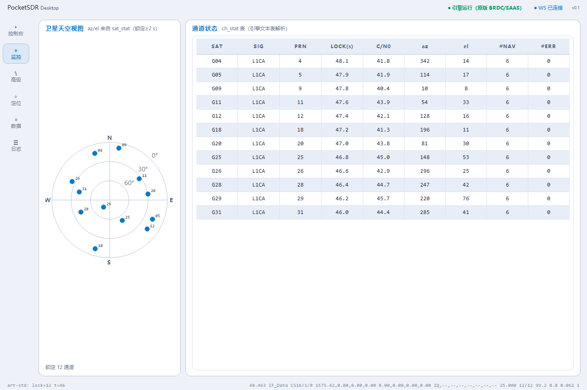
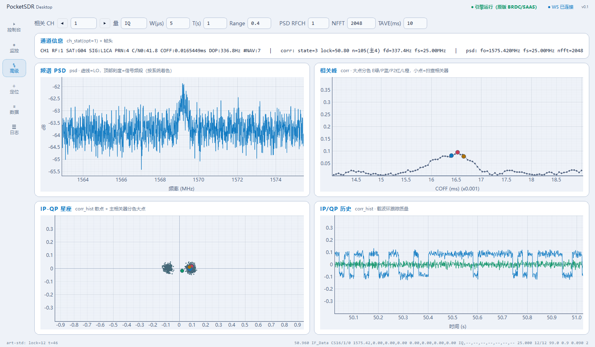
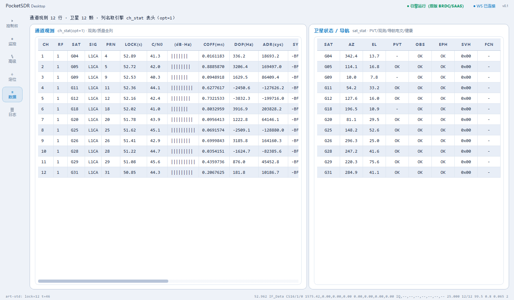
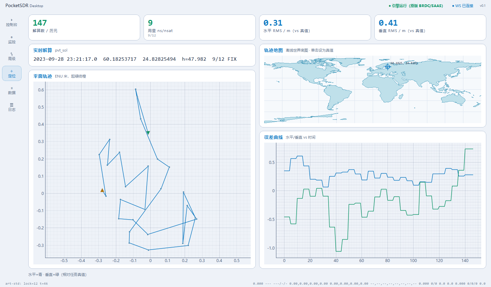

# 从仿真到定位（下）：PocketSDR Desktop 的功能、性能与实现原理（以 L1 C/A 信号回放为例）

> 上篇里，gnss-sim Desktop 把坦佩雷场景生成 6 GB 中频 IQ——Klobuchar 电离层、Saastamoinen 对流层、卫星钟差全要素注入，并由内置接收机的跟踪解自检通过。本篇讲接收端：用 RTKLIB 作者高須知治的开源软件接收机 PocketSDR 的桌面版 PocketSDR Desktop，以**标准版接收配置**回放上篇同一份全要素信号，检验两个完全独立的开源代码库互相印证的效果。全文同样以 GPS L1 C/A 为例，按功能、性能、原理展开，并说明与上游项目的继承关系。

## 一、这个工具是什么

PocketSDR 是筑波大学教授高須知治维护的开源 GNSS 软件接收机（当前版本 0.22）：捕获、跟踪、导航电文解码、定位解算全部在 CPU 上以软件完成，支持回放 IQ 文件，也支持 USRP、PlutoSDR、RTL-SDR 等前端实时采集。

PocketSDR Desktop 是本项目为它开发的桌面壳：控制台、监控、高级、定位、数据、日志六页的单窗口程序，把原来"命令行 + 浏览器"的操作方式收进一个桌面程序，并增加了几项针对"仿真—接收联合使用"的功能（下节列表）。它不改动接收算法本身——本篇的实测就是用**标准版引擎**（原版改正配置：广播星历 Klobuchar 电离层 + Saastamoinen 对流层固定改正）完成的。

## 二、与 PocketSDR 原版的继承关系和改进

继承的部分是核心：捕获/跟踪/电文解码引擎（sdr_func.c、sdr_rcv.c）与基于 RTKLIB 的定位内核（sdr_pvt.c）全部使用上游源码；IQ 回放文件格式（`.bin` + `.tag` 参数文件）、命令行参数、观测与 NMEA 输出也与原版一致——桌面版只是驱动它们。

在此之上的改进：

| 方面 | PocketSDR（上游原版） | PocketSDR Desktop（本项目） |
|---|---|---|
| 使用形态 | 控制台程序 + 自带浏览器界面 | PySide6 单窗口六页，exe 双击即用 |
| 改正配置 | 编译期定死（原版 PVT 固定 BRDC 电离层 + SAAS 对流层） | 引擎变体一键切换（原版 BRDC/SAAS、匹配大气关闭、IFLC 双频）；**本文实测全程使用标准版** |
| 真值关联 | 手工输入参考坐标 | "从 run 读取"：直接读 gnss-sim 场景 meta.json 的接收机真值，KPI 即对真值的误差 |
| 信号观察 | 浏览器图表（频谱/星座图） | 桌面重实现并扩展：C/N0 与锁定时间列表、IQ/相关峰/星座图（按 E/P/P2/L 角色分色）、PSD 频段刻度 |
| 数据出口 | 日志文件为主 | 观测表（每通道 26 列实时数据）与卫星状态表同屏 |
| 回归测试 | 无 | `--selftest` 自检：驱动完整回放并核对定位输出次数 |
| 构建 | MSVC 工程 | 源码级 g++ 独立构建配方，随桌面版分发预编译产物 |

## 三、接收链原理（以 L1 C/A 为例）

回放的输入正是上篇生态的产物：`out/.../gpssim.bin`，CS16（int16 交织 I/Q）、25 Msps、中心频率 1575.42 MHz、60 秒。接收链五级，每级都有对应的界面出口：

1. **下变频与重采样**：文件以零中频读入，按通道数与采样率参数（`.tag` 文件描述）重整；
2. **相关器组**：每通道用前置/立即/滞后（E/P/L）相关器对信号做本地码扩频相关，本地码相位与载波频率由环路闭环调整；细偏置 COFF、相关峰形状在高级页直接可见；
3. **跟踪环**：载波环（锁相/锁频）+ 码环（DLL），锁定质量用 C/N0 与锁定时间衡量，监控页逐星显示；
4. **电文解码**：L1 C/A 的 50 bps LNAV——20 ms 比特同步、奇偶校验、子帧 1-3 取广播星历，从 HOW 字拿到 TOW 完成时间对齐；
5. **定位解算**：RTKLIB 最小二乘，按原版口径固定扣减 Klobuchar 电离层与 SAAS 对流层改正，逐历元输出位置与卫星使用数；定位页对历元统计水平/垂直 RMS（相对真值）。

## 四、功能走查（实测截图）

控制台页：回放文件、格式参数、引擎变体卡片、真值联动都在一处。本篇选择"原版 BRDC/SAAS"标准变体。

监控页：12 颗可见星全部锁定，回放至 46 s 时逐星锁定时间已累积到 46~48 s——即开机即锁、全程无掉锁；C/N0 稳定在 40.4~45.7 dB-Hz（−18.33 dB 噪声注入下仍有这个余量），#NAV 每星已收齐 6 页导航电文，#ERR 清零；星空图与桌面端可见性推算逐星吻合（如 G29 仰角 76°，生成端记录 75.3°）。第一个定位解出现在回放后 31 s——与 LNAV 子帧 1-3 收齐、TOW 时间对齐完成的预期一致。

高级页：单星 IQ、相关峰与星座图，相关器大点按角色分色（E 绿 / P 蓝 / L 橙 / P2 红），PSD 图带 L1 C/A 频段刻度。

数据页：左表为每通道 26 列实时观测量，右表为卫星状态标志。

定位页：**147 个解算历元、9/12 星入解，水平 RMS 0.31 m、垂直 RMS 0.41 m**；平面轨迹收在 ±0.6 m 方框内，误差曲线全程在 1 m 带内，末历元 9/12 FIX。

## 五、性能与"注入—改正对齐"实验

回放对象是上篇的主场景：Klobuchar 电离层 + Saastamoinen 对流层 + 卫星钟差全注入、同一种子高斯白噪声的"全要素"信号。这个设置检验的正是上篇那条方法论的另一半：**仿真器注入了什么，接收机就该改正什么**。

PocketSDR 标准版的定位内核按原版口径固定做 Klobuchar + SAAS 改正——面对这份信号，这恰好是**正确**的做法：接收机用的电离层参数与仿真器注入时用的是同一份广播星历，对流层模型同名同参。两个互不知晓对方实现的代码库，在这份信号上会合：

| 口径 | 结果 |
|---|---|
| 标准版 CLI 全程 147 历元 | 水平 RMS **0.31 m**、垂直 RMS **0.40 m** |
| 末 10 历元均值 | N +0.10 / E −0.19 / U −0.04 m，3D **0.22 m** |
| 全场景最好历元 | 3D **0.11 m** |
| 桌面定位页 KPI | 0.31 / 0.41 m（与 CLI 统计一致） |

对一份 6 GB 的中频信号来说，这组数字意味着：仿真器写入的每一层延迟——电离层几米到十几米、对流层两到二十余米、卫星钟差数十公里级的时钟偏置——都被独立实现的第三方接收机按标准流程逐项还原，最终位置落在分米带。此前我们在反方向做过对照：同一场景把大气关闭后，标准版仍按惯例扣改正，垂直偏置立即抬到 −11 m 量级；逐项剥离可精确记账到每一项模型。**两个方向合起来才是完整结论：注入清单与改正清单必须对齐，多扣少扣都是实打实的米级误差。**

## 六、对科研与学习的实际支持

**独立第三方检验**。生成端（gnss-sim）与接收端（PocketSDR）来自两个互不依赖的代码库，改正策略各自独立：仿真器跟踪解自检合格只是"自证"，标准版 PocketSDR 对同一份信号复现 0.31/0.41 m 才是"他证"。这正是仿真工作最可信的评审方式。

**最好的"接收机方法课"教材**。注入—改正对齐实验把抽象原则变成可复现实验：同一份信号，只改接收配置或只改注入清单，误差就在分米与十米之间来回跳，每项改正的贡献可量化。学生会记住的不只是数字，而是"配置必须匹配信号内容"的排查思路。

**可观测性研究**。C/N0、锁定时间、少星生存能力（本例 9 星入解）、相关峰形状与多径响应的观察，都能用不同 SNR/多径注入的场景批量制造——上篇的生成端负责出题，这里负责答题，形成廉价、可控、可复现的数据闭环。

**源码级研究的低门槛入口**。C 源码结构清晰（引擎三个文件 + RTKLIB），本项目的构建配方示范了"如何安全地动一台软件接收机"：先建可回归的基线（--selftest），再做单点修改。命令行参数天然可脚本化，适合批量参数实验。

## 七、当前版本的边界

如实说明：实时采集仍走原版命令行/浏览器路径，桌面版聚焦文件回放；除标准版外另备"匹配大气关闭""IFLC 双频"两个实验变体（Galileo E1B 侧尚有一个约 +2.5 m 的共模偏置待查）；引擎变体按本项目配方源码编译，随桌面版分发预编译产物。

## 结语

两篇文章合起来是一条完整的闭环：gnss-sim Desktop 生成大气、钟差全要素注入的 L1 C/A 中频信号，并以独立代码的内置跟踪解自检；PocketSDR Desktop 标准版以另一套独立实现回放同一份信号，水平 0.31 m、垂直 0.41 m 复现分米级定位；加上反方向"关注入仍扣改正 → 十一米"的对照，"改正模型必须与注入模型对齐"从口号变成了双向可复现的实验。两个工具都免费开源、都不需要射频硬件，适合放进导航方向的课程、课题组和毕业设计里。

---

*工具获取：*
- *PocketSDR 上游项目：https://github.com/tomojitakasu/PocketSDR（ver. 0.22）*
- *PocketSDR Desktop 与 gnss-sim Desktop：https://github.com/HomeInSnow/gnss-sim（exe 双击即用）*
